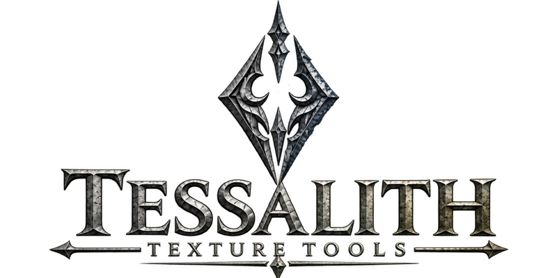

<p align="center"></p>

<h1 align="center">Tessalith</h1>

<p align="center">Converts texture source images to DDS for Skyrim SE/AE.</p>

---

Tessalith converts a folder of source images for Skyrim SE/AE. It works out what each file is from its name, groups files into material sets, packs loose maps into Skyrim's layouts, builds the mips and picks the format and colour tag each shader needs. The GUI (`tessalith.exe`) and the CLI (`sdc`) share one engine and one per-project `sdc.toml`, so both write the same bytes. Targets: `cs` (Community Shaders with TruePBR; default) and `vanilla` (which also packs the complex-material `_m` for a set given the complex material shader). It is for making new textures, not for fixing an installed game folder. Windows x64. Version 0.8.0 (see the [CHANGELOG](CHANGELOG.md)). GPL-3.0-or-later.

## Features

- BC1, BC3, BC4, BC5, BC6H, BC7 output
- Inputs: PNG, TGA, TIFF, EXR, PSD/PSB, Krita, OpenRaster
- SRGB / UNORM (Linear) tag chosen per map type and target shader
- Cutout alpha: coverage-preserving mips, on by default
- Optional exact-opaque alpha 255 where it's needed (forces BC7 mode 6's p-bit to 1; off by default)
- Normal mips renormalised
- Normal-mip variance baked into TruePBR roughness
- RNM normal-layer blending (`_bump`, `_detailnorm`, `_bent`, with optional masks `_bumpmask`, `_detailnormmask`, `_bentmask`)
- Multiple layers and duplicate types (`_bump2`) just work
- Loose maps automatically picked up and packed into `_rmaos` / `_rfaos` / complex `_m`
- Suffix-based channel remapping; ORM → RMAOS is instant
- Complex-material `_m` gate checked
- Complex grass (1:2 image, halves mipped apart)
- Mod scan: meshes decide alpha meaning and set shader
- Decode-and-check after every encode, with Skyrim rules
- Validate DDS files made by other tools
- GUI with encoded-mip preview, pixel readout, pin and compare
- TruePBR: PGPatcher JSON written per set, validated, with every option exposed, including the recent ones
- NiAlphaProperty (alpha blend/test) set in a familiar format
- Easy context-menu options for slots and lock commands
- Interactive colour picker with hex and RGB (0–255) inputs; outputs are converted to decimal
- PBR Landscape: PBRTextureSets and PBRMaterialObjects JSONs built from the actual EDIDs in your load order, no cross-referencing needed
- PGPatcher `_m` sidecar `.json`
- Batch / command line
- Fast scanning: 100,000 NIFs in 14 seconds, 1,500 plugins in under 3
- Doesn't need to be launched from MO2, but can be
- When launched from MO2, it fills in your MO2 location the first time; it doesn't rely on MO2's virtual file system, so it skips the middleman
- Optional NVTT backend for BC7 / BC6H encoding

## What it does differently

- **Starts from what the file is.** Suffix and folder give a sub-type; the sub-type sets format, tag, alpha and mips. Unclear files are skipped until you decide them.
- **Follows Skyrim's shader rules.** `_SRGB` only on TruePBR colour under `cs`; BC4/BC5 on a normal map is blocked, since Skyrim reads Z directly.
- **Reads your load order.** A GUI scan of MO2 meshes and plugins gives each diffuse its alpha meaning.
- **Checks its own output.** Every file is decoded and checked; a manifest lets re-runs redo only what changed.

## Uses the best encoder available 

BC7E for BC7, rgbcx for bc1 - 5, Intel ISPC for BC6h

GPU and CPU mixed BC7
| Encoder | Speed (s/Mpix) | Δ RGB (real) | Δ (real alpha) |
|---|--:|--:|--:|
| NVTT Normal (GPU) / texconv GPU | 0.03–0.09 | −1.4 / −1.8 | −0.75 / −2.8 |
| ISPC basic | 0.11 | −0.75 | −0.69 |
| bc7e u4 | 0.12 | −0.39 | −0.36 |
| bc7e u5 | 0.22 | +0.01 | −0.03 |
| bc7e u6 | 0.28 | 0 | 0 |
| ISPC slow | 0.30 | −0.59 | −0.67 |
| NVTT Production/Highest | ~14 | −0.32 | −0.37 |
| texconv CPU (-bc x) | ~16–20 | −1.6 | −2.4 |
| Compressonator q1.0 | ~33 | −0.16 | −1.50 |

BC7E vs only cpu encoders at maximum settings (besides ISPC)
| Measure | bc7e -u5 | NVTT 3 Production | Compressonator q1.0 | Intel ISPC slow | texconv -bc x |
|---|--:|--:|--:|--:|--:|
| Real colour textures | +0.03 | −0.27 | −0.16† | −0.44 | −1.47 |
| Smooth gradients (synthetic) | 0.00 | +3.86 | +3.21 | +0.73 | −6.89 |
| Real decals, smooth alpha | −0.02 | −0.06 | −1.50† | −0.58 | −2.04 |
| Packed data maps (RGB PSNR, dB) | 41.22 | 41.58 | —† | 41.20 | 40.38 |
| Normal maps (mean angle error) | 1.77° | 1.71° | —† | 1.79° | 2.19° |
| Opaque input decoded with alpha 254 | 28%*  | 0% | 1.1% | 15% | 2.4% |
| Time per megapixel | 0.22 s | ~14 s | ~33 s | 0.30 s | ~20 s |

  Optional patch for when that's not acceptable (mode 6 pbit override, exact opaque)
† Compressonator q1.0 was not re-measured on the wider set; its values come from the original 4–7 images. On those images it was 0.15 dB behind NVTT on packed data and 0.27° behind on normals. 
The alpha-254 and timing rows are also from the original run.

| Format and measure | rgbcx | NVTT 3 | Compressonator | Intel ISPC | texconv(CPU) |
|---|--:|--:|--:|--:|--:|
| BC1 colour (RGB PSNR, dB) | 39.85 | 39.74 | 39.05 | 38.11 | 37.41 |
| BC3 colour + alpha (premultiplied PSNR, dB) | 49.20 | 49.29 | 48.75 | 48.02 | 48.07 |
| BC4 masks (PSNR, dB) | 45.59 | 45.05 | 45.19 | 43.70 | 43.94 |
| BC5 normals (mean angle error) | .41° | .47° | .45° | .55° | .56° |
| BC6H HDR (multi-exposure PSNR, dB) | — | 48.00 | —† | 50.38 | 49.62 |
| BC6H brightest highlight kept (worst image) | — | 94% | 29%† | 22% | 29% |

rgbcx beats NVTT on BC1 on 96 of 100 images, and BC3 is a tie. 
Texconv GPU path is both slower than ISPC on BC6H and looses -1.8 db

† Original 4 HDRIs only; its mPSNR there was 1.2 dB below ISPC. 
## RNM vs alternatives

Ways to put a detail normal on a base normal:

| Method | How it combines | Preserves | Artifacts | Cost | Use for |
|---|---|---|---|---|---|
| Linear / overlay | Per-channel add or overlay, renormalise | Neither map exactly | Flattened detail; overlay treats vectors as colour | Lowest | Faint detail, previews |
| Partial derivative (PD) / UDN | PD adds slopes (xy/z); UDN adds xy, keeps base z | Slopes at small angles | UDN flattens detail; both lose accuracy as the base tilts | Low | Real-time multi-layer shaders |
| Whiteout | Adds xy, multiplies z, renormalise | More detail than UDN | Still approximate on steep bases | Low | Cheap shader blends |
| RNM (Barré-Brisebois and Hill) | Rotates the detail into the base normal's frame | Detail as seen on the tilted surface; flat inputs leave the other unchanged | None in normal use; needs unit vectors | A little more | Highest quality: baking or high-end shaders |

What Tessalith does (`crates/engine/src/rnm/`):

- **Method:** RNM for `_bump`, `_bump2`, `_detailnorm` and `_detailnorm2`. Bump layers are height: slopes from the mean of RGB become normals first. `_bent` defaults to an AO blend: a renormalised linear mix weighted by strength × (1 − AO)^1.5 × mask, AO from `_ao` (R) or `_rmaos`/`_rfaos` (B). With no AO map the weight is uniform and `RNM-AO-MISSING` is reported. `rnm.bent.mode = "detail"` blends it with RNM instead.
- **Order and strength:** `bent` 0.35, `bump` 0.4, `bump2` 0.4, `detail` 0.6, `detail2` 0.3, in that order; `rnm.order` moves listed layers to the front. Strength scales the layer's slope (0 flat, 1 as authored); a mask's R channel scales it per texel.
- **Where:** into the set's `_n` or `_cnr`, after decode and green flip, before mips. Layers are resampled to the base size. Alpha is untouched, so `_cnr` coat roughness passes through. The TruePBR roughness bake reads the blended normal.

Defaults assume _Bent is a high to low mesh only bake from the same normal source (It contains all detail the normal has, mask is used to reduce the ao strengh) use RMM mixing for when that is not the case.
## Quick start

Build with Rust stable and the MSVC Build Tools ([Installation](docs/wiki/Installation.md)). This writes `sdc.exe` and `tessalith.exe` to `target\x86_64-pc-windows-msvc\release\`:

```
cargo build --release -p sdc -p sdc-gui
```

**GUI:** run `tessalith.exe`, **Open folder…**, pick the **Mode**, settle any amber-bordered texture, **Export**. Decisions go to `sdc.toml`; **Copy CLI command** gives the matching `sdc convert` line.

**CLI:**

```
sdc inspect textures --recursive
sdc convert textures --recursive -o out --accept-suggestions high
sdc validate out\textures\armor\iron\iron_n.dds --target cs
```

Exit codes: 0 done, 1 some files failed or were skipped, 2 usage or config error, 3 fatal, 4 validation failed.

**Unsigned exe.** The release exes are not code-signed, so Windows SmartScreen may warn on first run. Click **More info**, then **Run anyway**. This is an alpha: back up your mod folders first.

## Where your data lives

| What | Where |
|---|---|
| GUI settings | `%APPDATA%\sdc\gui.toml` |
| CLI/GUI user config | `%APPDATA%\sdc\config.toml` |
| User presets | `%APPDATA%\sdc\presets\` |
| Mod scan database | `%LOCALAPPDATA%\sdc\scan.db` |
| GUI crash logs | `%LOCALAPPDATA%\sdc\logs\crash-<date>-<time>.log` (the CLI writes none) |
| Per-folder settings | `sdc.toml` and `sdc-project.toml` in the folder you convert |
| Unsaved edits after a crash | `sdc.toml.recovery`, `sdc-project.toml.recovery`, beside the original |

## Known issues and changes

See [Known issues](docs/wiki/Known-Issues.md) and the [CHANGELOG](CHANGELOG.md).

## Documentation

| Start | Use | Reference |
|---|---|---|
| [Home](docs/wiki/Home.md) | [GUI guide](docs/wiki/GUI-Guide.md) | [CLI reference](docs/wiki/CLI-Reference.md) |
| [Installation](docs/wiki/Installation.md) | [Texture types](docs/wiki/Texture-Types.md) (packing, TruePBR, RNM, grass) | [Project config](docs/wiki/Project-Config.md) |
| [Getting started](docs/wiki/Getting-Started.md) | [Mod scanning](docs/wiki/Mod-Scanning.md) | [Presets and targets](docs/wiki/Presets-and-Targets.md) |
| [FAQ](docs/wiki/FAQ.md) | [NVTT backend](docs/wiki/NVTT-Backend.md) | [Validation and output](docs/wiki/Validation-and-Output.md) |
| [Troubleshooting](docs/wiki/Troubleshooting.md) | [Research behind the defaults](docs/wiki/Research.md) | |

Design records: [docs/DECISIONS.md](docs/DECISIONS.md), [docs/RULINGS.md](docs/RULINGS.md), [docs/presets-changelog.md](docs/presets-changelog.md) and the research pages in [docs/research/](docs/research/README.md).

## Credits and licence

Tessalith is licensed under GPL-3.0-or-later; see [LICENSE](LICENSE). It builds on bc7e and rgbcx (Rich Geldreich / Binomial LLC), the Intel ISPC Texture Compressor and bcdec, among others. Third-party licences and the changes made to vendored code are listed in [THIRD_PARTY_NOTICES.md](THIRD_PARTY_NOTICES.md) and [LICENSES/](LICENSES/). Credits for ideas and prior work, including AlphaBloom's Auto Coverage, Ignacio Castaño's coverage-preserving mips and jiayev's TruePBR-Manager, are in [docs/CREDITS.md](docs/CREDITS.md).
