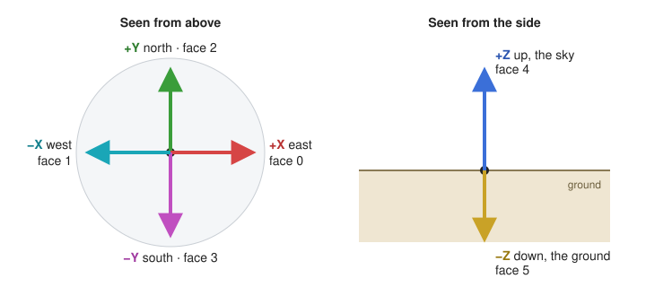
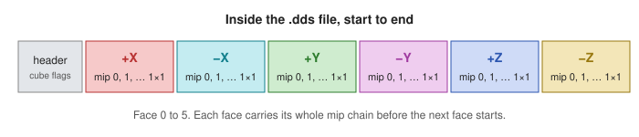
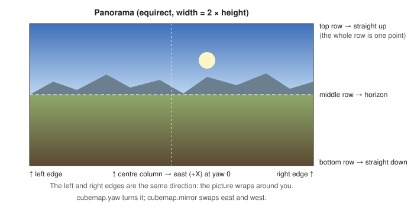
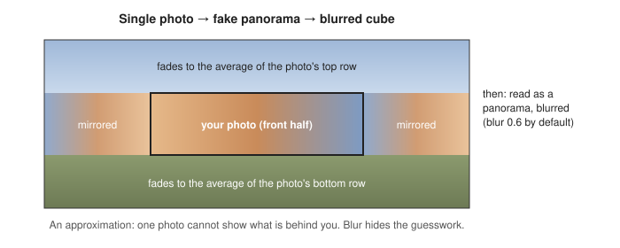
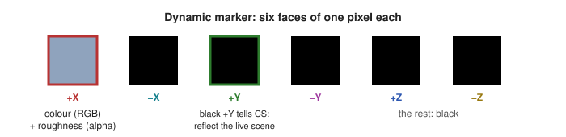

# Cubemaps

> **Coming in 1.1.0.** This page describes cubemap support in the 1.1.0 release. In 1.0.0, Tessalith refuses cube DDS files.

A cubemap is six square pictures, one for each direction around a point. Skyrim uses them for reflections: the `_e` texture on Environment Map and Eye shaders (NIF slot 4), plus room reflections in caves and temples. Tessalith takes six faces, a cross, a strip, a 360° panorama, a mirror ball, an angular map or a single photo, and writes a correct cube DDS with a full mip chain.

## Which face is which

Skyrim's world has X pointing east, Y north and Z up. Each face is named after the direction it shows:



| Face | Index | Shows | File suffix |
|---|---|---|---|
| +X | 0 | east | `_posx` or `_px` |
| −X | 1 | west | `_negx` or `_nx` |
| +Y | 2 | north | `_posy` or `_py` |
| −Y | 3 | south | `_negy` or `_ny` |
| +Z | 4 | **up: the sky** | `_posz` or `_pz` |
| −Z | 5 | **down: the ground** | `_negz` or `_nz` |

**The sky is +Z, not +Y.** Many tools and tutorials for other games put the sky on +Y. In Skyrim, +Y is north.

### How each face is turned

Each face is a square image, and each edge of that image points somewhere in the world. This was measured in game, and it is plain DirectX cube addressing:


Compared with what you would see standing in the middle of the cube, every stored face is mirrored. If your six images are views from the centre (sky at the top for the four side views, north at the top for the sky and ground views), set these per face:

| Face | What to change |
|---|---|
| +X east | rotate 90° clockwise, then mirror left-right |
| −X west | rotate 90° clockwise, then flip top-bottom |
| +Y north | flip top-bottom |
| −Y south | mirror left-right |
| +Z sky | mirror left-right |
| −Z ground | mirror left-right |

Both settings are six-entry lists in face order (+X, −X, +Y, −Y, +Z, −Z), on the cube's entry:

```toml
[files."textures/cubemaps/chrome_e"]
cubemap.face_rotate = [90, 90, 0, 0, 0, 0]          # clockwise, applied first
cubemap.face_flip = ["h", "v", "v", "h", "h", "h"]  # h mirrors left-right, v flips top-bottom
```

They work on every layout, six separate files included. Faces exported by a cube tool (texassemble, CubeMapGen, cmft) are usually stored this way already and need no setting.

### Inside the file



Tessalith always writes:
- all six faces;
- every mip level down to 1×1, built across faces so no seams appear;
- a UNORM format (BC1, BC3, BC7 or RGBA8). An sRGB tag on a cube is refused.

### Colour

Community Shaders reads a static cube with the game's own curve, `pow(colour, 1.6)`, not the sRGB curve. Tessalith does the same:
- A PNG, TGA or other normal image is read as game-gamma colour. Mips, blur and resizing are done in linear light, then stored back with the same 1.6 curve.
- A `.hdr` or `.exr` source is linear light already and is only stored with the curve.
- The setting still reads `color.content = "srgb"` for a cube. On a cube it means the game's 1.6 curve. Other texture types keep the real sRGB curve.
- The colour settings below (brightness, contrast, midtones, saturation, tint) also work on that curve, so a change looks the same in game.

## Ways to make one

| You have | What it looks like | How Tessalith knows |
|---|---|---|
| [Six images](#six-images) | six squares | file names end in a face suffix |
| [A cross](#crosses-and-strips) | a T-shaped net, 4:3 or 3:4 | from the shape |
| [A strip](#crosses-and-strips) | six squares in a row, 6:1 or 1:6 | from the shape |
| [A panorama](#panorama) | a 2:1 wide photo | from the shape, exactly 2:1 |
| [A mirror ball or angular map](#mirror-ball-and-angular-map) | a circle in a picture | you set `cubemap.layout` |
| [One ordinary photo](#single-photo) | any picture | you set `cubemap.layout = "photo"` |
| [A cube DDS](#an-existing-cube-dds) | a `.dds` cube | the file says so |
| [Nothing: a dynamic marker](#dynamic-marker) | no picture | `sdc cubemap-marker` |

A file is treated as a cubemap when its name ends in `_e` (for example `chrome_e.png`) or it sits under a `cubemaps` folder. Tessalith suggests the `cubemap` type for these with High confidence.

Only a crisp shape is detected: 4:3, 3:4, 6:1, 1:6 and exactly 2:1 (a 4096×2049 image is not). A square image with no layout set is skipped (`SUG-LOW-CONFIDENCE`), because it could be a mirror ball, an angular map or a photo. Mirror balls, angular maps and photos are never detected: set `cubemap.layout` for that file in `sdc.toml`. You can set any layout yourself, and an explicit `equirect`, `mirror_ball`, `angular` or `photo` takes an image of any non-zero size.

```toml
[files."textures/cubemaps/studio_e.png"]
cubemap.layout = "mirror_ball"   # faces, hcross, vcross, hstrip, vstrip, equirect, mirror_ball, angular, photo
```

### Six images

Name them with the base name plus a face suffix:

```text
textures\cubemaps\
  chrome_e_posx.png   east
  chrome_e_negx.png   west
  chrome_e_posy.png   north
  chrome_e_negy.png   south
  chrome_e_posz.png   sky
  chrome_e_negz.png   ground
```

They become one `chrome_e.dds`. The six files are one set, so the shader check sees a single `_e`. A face tag on any other name is left alone: `rock_px.png` is its own texture.

Tessalith never guesses a face. These are errors (`CUBE-FACES`), and the faces are not converted:
- two files for one face;
- a missing face;
- a face that is not square;
- faces of different sizes;
- faces that resolve to different settings (one file has its own `[files]` entry, for example). Set things for all six with a rule or `[defaults]`, so they match.

### Crosses and strips


The shape tells Tessalith the layout: 4:3 is a horizontal cross, 3:4 a vertical cross, 6:1 a horizontal strip and 1:6 a vertical strip. The match is exact. Cell positions are the ones texassemble uses.

Cells are read as stored faces: Tessalith never moves a face to another cell. In Skyrim, the sky goes in the **centre** cell of a cross (+Z), not the top one.

- A cross made by a tool that puts the sky on top shows the sky to the north in game. Rearrange the cells first, use six images, or export a panorama from that tool instead.
- Tools disagree on the vertical cross's bottom cell. Tessalith turns it 180° by default. If the ground comes out upside down, set `cubemap.vcross_negz_rotate = false`.
- A 4:3 photo named `_e` is not mistaken for a cross: a cross's empty cells must be flat, or the file is refused with a message pointing at `cubemap.layout`. A layout you set yourself is trusted.
- A layout that does not fit the image (`hstrip` on a 512×512 file) is `CUBE-FACES`.

### Panorama



Also called equirectangular or lat-long. This is what 360° cameras, HDRI sites and skybox generators produce. `.hdr` and `.exr` panoramas work too. The centre column faces east, and the picture runs clockwise seen from above (north a quarter of the way in, south three quarters).

An exact 2:1 image is read as a panorama without any setting. Any other size needs `cubemap.layout = "equirect"`.

- **Checked in game:** a cube made from a panorama by Tessalith showed north, south, east and west where they belong, with no mirror and no swap.
- **Turning:** `cubemap.yaw` turns the cube (in degrees, clockwise seen from above, so 90 moves east to south), and `cubemap.mirror` swaps east and west.
- **HDR:** an HDR sky with a bright sun needs `cubemap.highlight_clamp`, or the sun blows out the whole reflection.

### Mirror ball and angular map


Both are pictures with the scene in a circle. Set the layout yourself, because a square image could be anything:
- `mirror_ball` is a photo of a chrome ball;
- `angular` is a light probe.

Both assume the camera stood south of the ball looking north, with east on the right of the picture. Use `cubemap.yaw` to turn the result. The circle's radius is half the picture's width, which sets the default face size. The point directly behind the ball is stretched, as in any ball photo.

### Single photo



One photo can't show what is behind you, so this mode makes a believable reflection rather than a true one. Set `cubemap.layout = "photo"`. Tessalith builds the fake panorama shown above (the photo in front, mirrored copies behind, and the top and bottom fading to the average colour of the photo's top and bottom rows), makes a cube from it and blurs it hard: `cubemap.blur = 0.6` unless you set another value, even when a style sets one. It works well for shiny metal and glass, where the reflection only needs the right colours and light. The default face size is half the photo's width.

### Face size

The face size is `cubemap.face_size`, or the largest power of two that fits inside one cell of the source, at most 4096. A 1536×1152 cross has 384-pixel cells and becomes 256. For a panorama the cell is a quarter of the width, for a mirror ball or angular map half the width, and for a photo half the photo's width. Larger values scale up. Tessalith notes `DIM-RESIZED` when the face differs from the cell. A cube is never checked for `DIM-NPOT`.

### An existing cube DDS

A cube DDS goes through the same size, filter, blur and format settings as any other source. Like any DDS, it is skipped (`IN-DDS-SKIPPED`) unless you set `reencode = true` on the file. That costs some quality, because the faces are decoded and encoded again.

- It is always read as its six mip-0 faces. `cubemap.layout` must be unset (or `hstrip`) for it.
- It can only be re-encoded as a cubemap.
- Cube arrays are refused, and `sdc patch-header` still refuses cubes.

### Dynamic marker



Community Shaders (and ENB) read a 1×1 cube whose +Y is black as an instruction to reflect the live scene, not as a picture. The +X pixel then sets the reflection's colour (RGB) and roughness (alpha). Write one on purpose:

```text
sdc cubemap-marker --color 200,200,210 --roughness 0.3 -o textures\cubemaps\steel_e.dds
```

- `--color` is written as raw code values. Community Shaders reads F0 as `(code/255)^1.6`.
- The colour sits on the +X face. +Y stays black, so the file is always a dynamic marker.
- `--roughness` is 0 to 1 and is stored in alpha as `min(round(r × 255), 254)`. Leave it out and alpha is 255, which gives Community Shaders' defaults (F0 1, roughness 1/7).

The file is 152 bytes. See [CLI reference](CLI-Reference.md#sdc-cubemap-marker). Tessalith never writes a picture cube at 1×1 by accident, so a real cube can't turn into a marker.

## Settings

All are optional and set per file or in `sdc.toml`, under `[defaults]`, `[subtypes.cubemap]`, a rule or a `[files]` entry. They also work with `--set`. Ranges and defaults are in [Project config](Project-Config.md#cubemap).

| Key | What it does |
|---|---|
| `cubemap.style` | Starting point for size, format and blur (below) |
| `cubemap.layout` | Source layout, when the shape doesn't settle it |
| `cubemap.face_size` | Face size in pixels (a power of two, 4 to 4096) |
| `cubemap.yaw`, `cubemap.mirror` | Turn the cube about the up axis (degrees, -360 to 360); swap east and west |
| `cubemap.face_rotate`, `cubemap.face_flip` | Turn or flip single faces: six entries in face order (0, 90, 180, 270; `h`, `v`) |
| `cubemap.vcross_negz_rotate` | Whether the vertical cross's bottom cell is turned 180° |
| `cubemap.blur` | 0 (sharp) to 1 (very soft) |
| `cubemap.exposure`, `brightness`, `contrast`, `midtones`, `saturation`, `tint` | Colour adjustments |
| `cubemap.highlight_clamp` | Soft-compresses bright highlights so a chosen level becomes full white |
| `cubemap.ground_fill`, `cubemap.horizon` | Replace everything below the horizon with a colour or a gradient |

### Styles

| `cubemap.style` | Use it for | Starts at |
|---|---|---|
| `vanilla_metal` | armour, weapons, ore, glass | 32 px, BC1, strong blur |
| `room` | interior room reflections, caves | 128 px, BC1, medium blur |
| `eye` | eyes | 256 px, BC7, medium blur |
| `hd` | close-up shiny surfaces | 512 px, BC7, light blur |

Every value a style sets can be overridden by its own key. `vanilla_metal` also lowers saturation to 0.8.

### Ground fill and horizon

A panorama or photo often shows the photographer's feet or a patchy floor. `cubemap.ground_fill` covers everything below the horizon line:
- `"gradient"` takes the average colour at the horizon and darkens it towards straight down, to half at the bottom;
- `[r, g, b]` is a flat colour. The three numbers (0 to 255) are code values on the game's 1.6 curve, like `cubemap.tint`, not sRGB.

`cubemap.horizon` sets where the line sits, from -45 to 45 degrees (0 is level; positive is above it). It blends over about two degrees around the line. If `ground_fill` is not set, nothing is filled and `horizon` does nothing. A bad value is an error naming the two accepted forms.

```toml
[files."textures/cubemaps/studio_e.png"]
cubemap.ground_fill = [30, 28, 26]
cubemap.horizon = -10
```

### Order of work

Tessalith applies the settings in this order: import, face rotate and flip, yaw, mirror, exposure, highlight clamp and colour, ground fill, blur, mips.

### Blur

`cubemap.blur` blurs the cube evenly across the faces, so no seams show. It is a cone blur, not the GGX filter a game engine might use for rough metal. The default is no blur, unless a style sets one.

### HDR sources

An `.hdr` or `.exr` face whose brightest value is above 1 and that has no `cubemap.highlight_clamp` gets `LOSS-CLAMP-HDR`. A bright sun would otherwise clip to white. Set `cubemap.highlight_clamp` to the level that should become full white. Brightness is rolled off smoothly toward it, so darker values come down a little too, and hue is kept.

## Checks

A cube has no mips: `CUBE-NO-MIPS` warns when `mips.levels` is `none` or 1. A cube without mips sparkles and looks pixelated in game.

`sdc inspect` and `sdc validate` flag these broken cube files (as `VAL-HEADER` warnings in `validate`, and they fail the file):
- a cube wider than 1 pixel with only one mip (a 1×1 marker is not flagged);
- a flat 2D texture whose name ends in `_e`, or that sits in `textures\cubemaps\`, where a cube is expected;
- a 1×1 cube whose +Y isn't black (Community Shaders shows it as a nearly black static reflection);
- a cube in an sRGB format.

Note that the second check fails a 2D `_e` or `cubemaps\` file that earlier versions passed. The game reads those files as cubes, so a 2D one is a fault.

The messages read:

- `2D texture where a cubemap is expected (the game reads _e and textures\cubemaps\ files as cubes)`
- `cube has no mips: curved surfaces will sparkle; re-encode it with a full chain`
- `1x1 cube with a non-black +Y: Community Shaders treats it as a static, near-black reflection, not a dynamic-cubemap marker`
- `cube uses an sRGB format; Community Shaders expects UNORM cubes`

`sdc validate` judges a cube file as a `cubemap` unless you pass `--subtype`. A marker passes: its colour sits on +X and +Y stays black.

The GUI lists cube files for now. Its cubemap settings come in a later release; use `sdc.toml` or the CLI until then.
