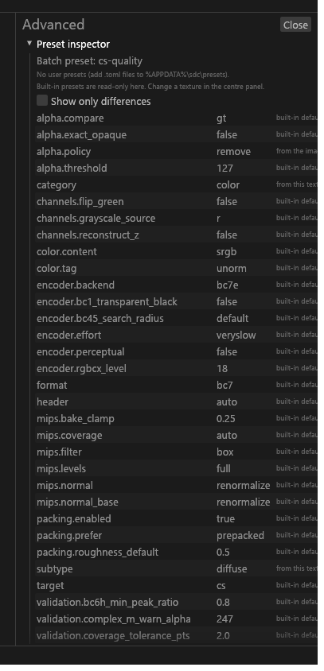

# Advanced drawer

The drawer at the right edge of the Textures view: settings that are not per texture, plus a few rarely used texture fields. For anyone setting up NVTT, threads or the interface, or reaching a texture field the panel does not show.

## Advanced drawer

Click the strip at the right edge to open it. With a set selected in 2D, the same sections are the set editor's last tab, **Advanced**, and the open or closed choice is shared by the tab and the drawer. In 3D, with a texture selected, or with several sets selected, the drawer is at the right edge.

| Section | Contents |
|---|---|
| Preset inspector | Headed *How {file}'s settings resolve* for the selected texture. Under it: the batch preset, and the user presets that loaded (with their files); with none loaded, a **Presets…** button opens the preset creator. Field names read in words (the key shows on hover); long values are cut to fit and show in full on hover. *Show only what differs from sdc-base* hides values equal to the base preset. Built-in presets are read-only. |
| Batch | Worker threads, Memory budget (MiB), BC1 decoder (Ideal, Ideal (round 4), NVIDIA, AMD). The BC1 decoder is read at start, so a change shows "restart Tessalith to apply". |
| NVTT | The NVTT path, **Choose nvcompress.exe…**, or **Automatic** (`PATH`, then the NVIDIA install folder). NVTT is never bundled. The status shows the version found and whether it is the tested 3.2.5, and is re-checked when the window regains focus. See [NVTT backend](NVTT-Backend.md). |
| Project-wide fills (legacy) | One line, shown only while `sdc.toml` holds fills in `defaults.packing.fill.*`. **Clear** removes them; set fills on each packed output's card instead ([Fills and defaults](Texture-Packing.md#fills-and-defaults)). |
| Preview | Largest previewed side, Allow 16384 previews, Live encode. |
| Mipmaps | Levels for the selected texture. |
| Advanced texture fields | BC7 weighting ([BC7 weighting](GUI-Texture-Panel.md#bc7-weighting-against-bc3)), BC1 transparent black, BC4/BC5 search radius (*Default*, *Maximum*, *Fast (preview)*), rgbcx level, DDS header (Auto, DX10 extended header, Legacy FourCC), Resize, Half size. |
| Interface | **Reduce motion** ([below](#reduce-motion)). |
| Checks | The switches for the artist checks, **Measure whether full size adds anything** and **Check all UV coverage**. See [Artist checks](GUI-Artist-Checks.md#artist-checks). |
| Also export recipe | One box per `[export.legacy]` value of [Also export as Vanilla and CM](GUI-Also-Export.md#the-recipe). Starts closed; Review's link opens it. |
| Unmatched [files] entries | `[files]` entries that name no file under the current target, with **Remove**. |

The drawer edits one texture at a time, also with several selected.

**Resize** offers *None*, *Down to a power of two* and *Halve if larger than 512*:

- *Down to a power of two* shrinks each side to the largest power of two that fits: 1000×600 becomes 512×512.
- *Halve if larger than 512* halves both sides when the larger is above 512: 1024×512 becomes 512×256.

### Reduce motion

**Reduce motion** is off by default and saved in `gui.toml`. When on:

- movement stops: the toast rise, the progress glide, the press scale, and the scroll to a set you just moved or picked with *Go to set*;
- the fades Tessalith adds (toasts, the Export accent, the folder fade-in, and the fade at the end of the reorder and slot flashes) shorten to about an eighth of a second. The flashes still hold for about a third of a second first.

The system's own motion (menus, dialogs, collapsing headers) is not changed.

Results Tessalith reads in the background (output sizes, the *Used by meshes* list, the report save) can appear up to a quarter of a second after a foreground result.
