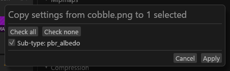
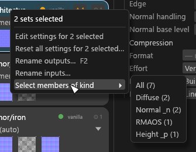
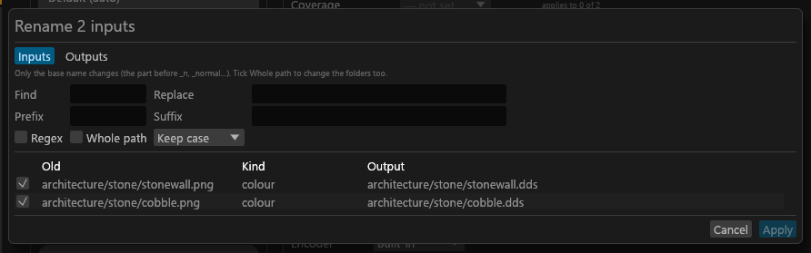
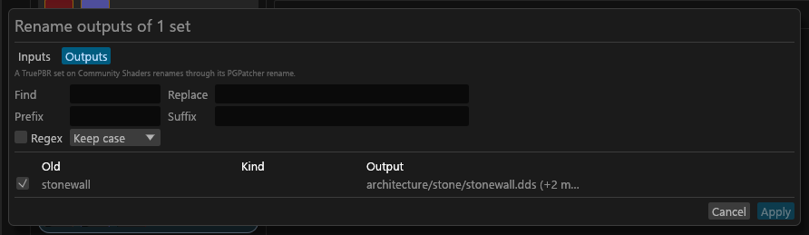

# Bulk editing and renaming

How to select several textures or sets and edit them together, and how to read files or write outputs under other names. For anyone fixing many files at once.

## Bulk editing

### Selecting several

In the Textures or Sets column:

| Input | Effect |
|---|---|
| **Ctrl+click** | Adds or removes one entry. |
| **Shift+click** | Selects the range from the last clicked entry, in the order shown (search and filters applied). |
| **Ctrl+A** | Selects everything shown (in the Sets column, the visible sets only). With nothing shown, because a filter hides everything, it does nothing and keeps the selection. |
| **Esc** | Closes a popup, the preview or a dialog. It never clears the selection; *Clear the selection* is in the command palette (Ctrl+K), with no key. <!-- D:FB11 --> |

Helper rows take Ctrl+click and Shift+click; a Shift+click range runs over the tiles, then the helper rows shown, and skips a collapsed Helpers group. Ctrl+A and the arrow keys (with or without Shift) cover tiles only.

Textures and sets are never selected together. The column heading counts the selection, for example "12 selected (4 hidden by filter)". Textures hidden by the search or a filter stay selected and are edited too. Sets work the same way ("2 selected (1 hidden by filter)").

### Editing them together

With two or more textures selected, the centre shows their settings in one panel:

- A row whose values differ reads *— mixed*. A row that applies to none of the selection and has no value reads *— not set*, greyed.
- Picking a value writes it to every selected texture that can take it. Rows you do not touch are never written.
- A row that some textures cannot take (a field locked for them, or one that does not apply, such as *Normal handling* on a diffuse) says *applies to K of N*. Hover it for the reasons.
- After each change, a line reports how many textures were written and why any were skipped.
- **↺** resets the field on all of them. A reset is not blocked by a lock.

With two or more sets selected, a row of chips picks which of their maps to edit: *All*, *Diffuse*, *Normal _n*, *RMAOS* and so on. Each chip shows its count, plus *applies to K of N sets* when some sets have no map of that kind.

### Right-click menu

Right-clicking a selected tile or set keeps the selection; right-clicking another one selects it alone. The menu offers:

- *Edit settings for N selected*.
- *Copy settings from <texture> to N selected…*: a checklist of the active (last clicked) texture's own settings, all ticked. Untick what you want to keep. A saved half size is one of the ticks (*Half size*). Textures only; to copy between sets, use *Select members of kind* first.
- *Reset all settings for N selected…*: removes their `sdc.toml` entries after asking. Acknowledged warnings are kept. A texture filling a pinned slot is skipped, and the report says so.
- For sets, *Select members of kind*, which turns the selection into those textures.
- *Show in Explorer* (one texture selected): opens Explorer with the source file selected. It is greyed out, with the reason, when the file is gone.

Every change of this kind is one undo step, and the folder is planned once. A read-only `sdc.toml` takes no bulk change. The Advanced drawer edits one texture at a time.

## Renaming

Right-click a texture or a set (or press **F2**) for the rename dialog. It has two modes:

| Mode | What it does |
|---|---|
| **Inputs** | Reads files under corrected names, for a source saved with the wrong name (a normal map without `_n`, or a file in the wrong folder). The name is written to `sdc.toml` as `[inputs."<file>"] as = "<new path>"`. The file on disk is never renamed, and `sdc convert` reads the same alias. The tile shows *read as <name>*. The file keeps its own settings and set membership, whatever name it is read as. *Clear input alias* in the tile menu removes it. |
| **Outputs** | Gives a set's outputs a new base name. Every output keeps its folder and its suffix (`steel.dds`, `steel_n.dds`, `steel_rmaos.dds`). On a TruePBR set (Community Shaders) this writes the set's PGPatcher **Rename**, so the JSON follows; on any other set it is saved in `sdc-project.toml`. Nothing on disk is renamed, and outputs already exported under the old name stay where they are. |

The dialog changes only the base name (the part before `_n`, `_normal` and so on):

- *Find* and *Replace*: tick *Regex* for a pattern, and use `$1` in *Replace* for a group.
- *Prefix*, *Suffix* and *Case*.
- In Inputs mode, tick *Whole path* to run them over the folders too, for moving many files to another folder at once. The map suffix and the extension still stay.
- Untick a row to leave it out.

The table shows each old name, the kind its new name reads as, and the output it writes.

**Apply** is greyed out while a row is red: two files or sets would end up with one name, a name Windows cannot use, a changed file extension, or an output name ending in a map suffix. Amber rows are warnings: a file whose name now reads as another kind of map, or an output that scanned meshes still use under its old name (renaming it leaves those meshes pointing at a file nothing writes). Packed outputs and textures in a pinned slot are skipped in Inputs mode. Apply is one undo step.

### Input name box

On the set editor heading, the **input name** box shows the path the set's textures are read as, and you can type a new one.

- While you type, the best known texture path shows in grey after the text. The known paths are every path the last mod scan saw in a mesh's diffuse slot, plus this project's own diffuse paths. **Tab** takes the grey text up to the next `/`, Tab again keeps going, and **Right arrow** at the end takes all of it.
- A list of up to 12 matching paths opens under the box as you type; its bold top row is the grey completion. **Up/Down** highlight a row, **Enter** uses the highlighted row (or what you typed when none is), and clicking a row uses it. The first **Esc** closes the list; Esc again puts the old name back.
- **Enter**, or clicking away, gives every member of the set an `[inputs]` alias with its own suffix and extension, as one undo step. Clicking away from an invalid or unchanged name also puts the old one back. The set's TruePBR settings, pins and borrows follow it.
- A name that cannot be used (outside the project's folder, a name another file already has, a pinned slot) gets a red outline, with the reason on hover, and is never applied.

The box works on path segments, the parts between two `/`:

- A **double-click** selects the segment under the pointer. A **drag** that crosses a `/` selects whole segments; hold **Alt** to select single characters. **Ctrl+A** selects everything.
- **Ctrl+Left / Ctrl+Right** jump to the previous segment's start or the next segment's end; with **Shift** they extend the selection.
- A `/` takes two presses of **Backspace** (or **Delete**) to remove: the first highlights it and says "Backspace again to remove the folder separator". A held Backspace stops at a `/`.
- **Ctrl+Up / Ctrl+Down** list the known names for the segment under the cursor. For a folder, the list shows the folders beside it; those that also hold the rest of the path are marked **✓** ("Has …" on hover) and come first. For the last segment, it shows the textures in that folder. **Up/Down** highlight a row, **Enter** or a click replaces only that segment, and **Esc** closes the list without changing anything. Picking a folder opens the next segment's list at once, with the old name highlighted when the new folder has it; when it doesn't, the closest names come first, nothing is highlighted, and the old name stays. With everything selected, Ctrl+Up/Down opens the ▾ list with every known path, not only those in the name's folder.
- A name that is no known texture shows its last segment in amber, with "No known texture at …" on hover. You can still use it.

The **▾** at the right lists the known paths under the folder before the last segment (never those under `textures\pbr\`, which are PGPatcher's outputs), with a filter box (all words must appear). Click one to use it. When that folder has none, use **Ctrl+Down** on a folder in the box, or **Ctrl+A** then **Ctrl+Down** for every path.

On a TruePBR set in the 2D view, the **Match** box beside the name box picks the slot the ▾ list works on:

- **Match 1 · Diffuse** is the list above.
- **Match 2 · Normal _n** to **Match 8 · Subsurface _s** (named as the set editor names the slot, with the key, `match2` and so on, on hover) list the textures the mod scan saw in that slot. A pick sets that slot's match in the PGPatcher JSON and renames nothing.
- Tick **All slots** in the list to see every known texture; a pick still goes to the selected match.

The box starts at the set's lowest unused match (Match 2 for a set whose only match is its own diffuse), or at the one you last chose for that set (`gui.toml` keeps it per project and set), and never moves by itself.

In a project with no `textures` folder in its path, the set names and the offered paths both leave out `textures/`.
