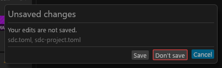
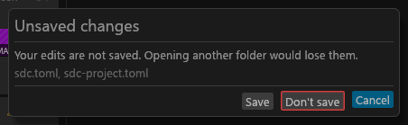
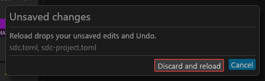
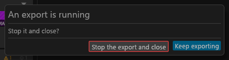
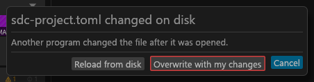
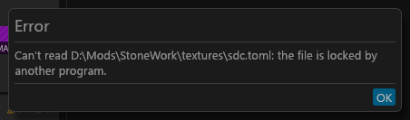
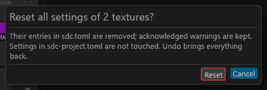

# Dialogs

How the GUI's dialogs behave: which key does what, how the buttons are laid out, and what each dialog's buttons say. For anyone who wants to know what Enter or Esc will do before pressing it.

## Dialogs

## Dialog keys

**Esc** is a dialog's Cancel (or Close), and so is a click outside it. The rename dialogs, **Copy settings** and **Fill from names** ignore a click outside, so a stray click cannot lose what you typed or chose.

**Enter** takes the safe default and never saves, deletes or exports: <!-- D:FC5 -->
- Cancel in the close and open unsaved-changes dialogs (back to the app; **Save** and **Don't save** need a click);
- Cancel in the reload, changed-on-disk and Reset all dialogs;
- **Keep exporting** in the export-running dialog;
- OK in an error or a refusal;
- Apply in the rename dialog and Fill in Fill from names.

In the "changed on disk" dialog Enter closes it without touching the file or your edits; it never overwrites. In the rename dialog Enter applies only while no widget has keyboard focus (typing in Find and pressing Enter still applies); with a row's tick or the Case list focused it does nothing. Copy settings, the Replace and set-choice questions, the discard question in the preset creator and Slot commands have no Enter default. Enter or Space on a focused red-outlined button (Don't save, Discard and reload, Overwrite with my changes, Reset, Delete, Stop the export) does nothing: those need a click. Esc with the rename dialog's Case list open closes the list first; a second Esc closes the dialog. Review's **Export** is a click only: Enter never exports.

## Dialog style

Every dialog is one frame: a title, the question, and a footer of buttons on the right. The footer reads left to right: plain buttons, then the destructive one, then the Enter default.
- The Enter default is drawn filled in the accent (teal) colour, so you can see what Enter will press. A dialog where Enter does nothing has no filled button.
- A destructive button (Don't save, Discard, Delete, Reset, Overwrite, Stop the export) has a red outline and is never the default.
- Each dialog is as wide as its cap: 420 points, Slot commands 640, the rename dialog 860. A button row too long for that width wraps onto a second row of the same height; the dialog never grows past that.
- A long file name is cut in the middle in the button labels (**Replace {name}**), and the question above them gives the whole name.

The buttons say what they do:

| Dialog | Buttons |
|---|---|
| Unsaved changes (close the window, open another folder) | Save, **Don't save**, Cancel (Enter) |
| Unsaved changes (Reload) | **Discard and reload**, Cancel (Enter) |
| An export is running | **Stop the export and close** (or **Stop the export and open the folder**), **Keep exporting** (Enter) |
| {file} changed on disk | **Reload from disk**, **Overwrite with my changes**, Cancel (Enter) |
| Error, and "Can't do that" | OK (Enter) |
| Reset all settings of {n} textures | **Reset**, Cancel (Enter) |
| Replace? (a drop onto a filled slot) | **Replace {name}**, Cancel; no Enter default |
| {name} is in {set} (a drop from another set) | **Move it here**, **Share (borrow its finished output)**, **Duplicate the source for this set** in the body; Cancel in the footer |
| Discard changes? (preset creator) | Cancel, **Discard**; no Enter default |
| Rename {id} (a set) | Cancel, OK; no Enter default (the name field's own Enter renames) |
| Rename {n} inputs, Rename outputs of {n} sets | Cancel, **Apply** (Enter, while it is enabled) |
| Fill from names | Cancel, **Fill** (Enter) |
| Copy settings | Cancel, Apply; no Enter default |
| Slot commands | Close; no Enter default |

Both unsaved-changes dialogs name the files with unsaved changes (`sdc.toml`, `sdc-project.toml`, or both). The automatic types of a plan alone, with no edit of yours, do not ask.

