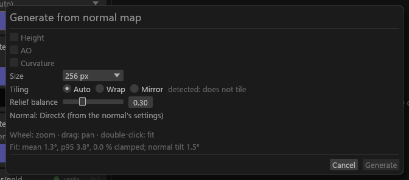

# Generate from normal map

The dialog that turns a set's normal map into a height map, an AO map or a curvature map. For sets that ship a normal but no height or AO. The generated file names, the two height ranges and how a real map takes over are in [Generated height maps](Set-Shaders.md#generated-height-maps).

## Generate from normal map

**Generate from normal map…** integrates the set's normal back into a height map and writes it as a source file next to the normal. Nothing changes until you click **Generate**; Enter never generates.

- **Where:** the Height row's right-click menu (an empty row's **Assign…** opens the same menu), and the set card's menu. A small **Generate…** button also sits directly under **Assign…** on an empty Height or RMAOS row, and under the format combo on a filled one; it reads **Regenerate…** when a generated file already fills the slot. It is hidden when the slot's item is a packed texture. The entry is greyed out, with the reason, when the set cannot use a height: vanilla multilayer, vanilla landscape, a shader that reads no height, no normal map, a normal whose sides are not powers of two, or a real height already there.
- **The dialog:** Size (256, 512 or 1024; up to 2048 on a `cs` PBR set whose albedo is larger; never larger than the normal; above 512 a warning about parallax cost; the `_m` alpha takes the `_m`'s size), Tiling (Auto, Wrap, Mirror), Relief balance and Strength, with a preview of the height and the fit. It shows the path it will write. On a complex-material set (vanilla target) **Use as** offers *Complex material `_m` alpha*.
- **The preview** in the dialog: the wheel zooms 1 to 16 times around the pointer, a drag pans, and a double-click fits. All tiles share one crop.
- A file that is already there is never overwritten.

**Where it shows.** The Height row's File hover adds "Generated from {normal}", and its Flags cell has a weak **generated** marker.

- When the generated file is out of date (the normal changed, the set now wants the other neutral, or the set's shader reads no height), the row's status dot turns amber, with "stale: {reason}" on its hover (`GEN-STALE`, Info). It is also in the texture's message list, and in a Problems warning row on the generated map with **Regenerate…**, so its set's dot is no longer ready until you regenerate.
- When a real `_p` (or `_height`) replaces the generated file (`GEN-REPLACED`, Info), the row offers **Delete generated file…**. `GEN-REPLACED` is never a Problems row.
- A `_height_generated` for the `_m` alpha has no row of its own: the `_m` block's alpha line carries the hover and a weak stale line.

**Regenerate…** (the same entry once a recorded file exists) opens the dialog with the settings the file was made with, corrected to the neutral the set wants now and to a size the normal still offers. It replaces the file only if it is unchanged since Tessalith wrote it; an edited file is refused with "…was edited since it was generated…". The set card's **Regenerate…** opens with the set's first recorded map ticked and the settings it was made with (Tiling, green, Relief balance, Strength, AO settings).

**Delete generated file…** (on the row, and as a submenu of the set card's menu) asks first: **Cancel** is the Enter default and **Delete** is outlined red.

- The box says when the file was edited since it was generated, or when Tessalith has no record of generating it. Your confirm deletes it either way, takes it out of the set if it was moved in with its normal, and forgets its record.
- A file that changes while the box is open is kept.
- The set card's submenu also names the real map that replaced a file.
- It cannot be undone.

**Records.** The records live in `sdc-project.toml`'s `[generated]` table, outside Undo. They are also written at once to `_sdc/generated.json` beside `sdc-project.toml`, with the JSON hash records, so a file you generated and then closed without saving is still "generated here" next time. Opening the folder copies them back into `sdc-project.toml` quietly (no unsaved changes; the file catches up at your next Save). Where the two disagree, `_sdc/generated.json` wins over a hand edit of `sdc-project.toml`.

## AO

The same dialog makes an ambient-occlusion map from the normal (a horizon march over the solved height). A baked AO is better: use this only when the set has none.

- **Where:** on the `_rmaos` row, the same menus as the height; from the set card it is the dialog's **AO** checkbox; and Regenerate.
  - It is offered only for PBR, PBR landscape and PBR grass sets on the `cs` target, whose `_rmaos` reads it. Elsewhere the entry and the checkbox say "AO is generated only for PBR sets under Community Shaders".
  - It is greyed out when slot 6 is pinned, when the set already has an AO source (a real `_ao`, or a pre-packed `_rmaos`/`_rfaos` image whose blue channel already holds AO, named with "(B)" in the reason, or one beside a loose roughness, metallic, specular or `_orm`), or when its `_rmaos` is a DDS (never re-encoded).
  - A pre-packed image whose blue is flat white: see [Generated height maps](Set-Shaders.md#generated-height-maps).
- **The AO group:** Radius (1.5625–25 % of the width, default 6.25 %, with its size in texels), Quality (8, 16 or 32 slices; 16 steps), Depth (0.25–4) and Intensity (0.5–3). The file holds raw visibility, and Community Shaders applies AO to indirect light itself, so 0.7–1.0 is a good Intensity. The preview runs at 8 slices × 8 steps and adds "AO: mean …, … % of texels below 0.5".
- **Size:** with only AO ticked, the Size is AO's own default. One Size serves all ticked maps, each capped at its own limit (the height at 1024, or the albedo's size up to 2048 on a `cs` PBR set; AO at 2048). When the set has other `_rmaos` sources (roughness, metallic, specular), the AO takes their size, shown read-only, because a packed `_rmaos` needs one size; a normal smaller than them disables AO with the reason. The path lines show each file's size.
- **The file** becomes the `_rmaos` B channel on the next plan, with the Info note `GEN-AO` in place of `PACK-DEFAULTED`. It fills no row of its own: the `_rmaos` row's File hover says "AO generated from {normal}" (no **generated** marker, because the packed `_rmaos` itself is not generated), its AO fill line says "Generated from {normal}", a stale AO turns that row's dot amber, and that row's menu offers **Delete generated file…**.
- **Bent normals:** with an RNM bent layer, the dialog warns at the top that a generated AO also changes the normal map ([why](Set-Shaders.md#generated-height-maps)).

## Curvature

The dialog's **Curvature** checkbox writes `<base>_curves_generated.png`: the Laplacian of the same height solve, smoothed over about 2 texels at the solve size (up to 1024 px; a 2048 curvature is upsampled, so about 4 of its texels), 0.5-centred, with peaks bright and hollows dark. Its hover says "used by Also export as: Vanilla / Complex material": only Also export's soft-light step reads it, so a plain export reports it as `PACK-UNUSED-INPUT`, which is expected.

- **Where:** the set card's menu (the dialog's **Curvature** checkbox) and Regenerate. It has no slot row.
  - It is offered only where Also export reads it: PBR, PBR landscape and PBR grass sets on the `cs` target with no DDS member (Also skips such a set). On other sets the greyed entry reads "curvature is read only by Also export, which reads PBR sets under Community Shaders", or names the DDS.
  - It is greyed out when the set has no normal, the normal is not a power of two, the set already has a real `_curves` or `_curvature` map, or a `_curves_generated` file Tessalith did not write is there.
- **Size:** the set's albedo size, shown read-only, because Also's diffuse reads the albedo and the curvature together. A normal smaller than the albedo, or an albedo whose sides are not powers of two, disables Curvature with the reason. A set with no albedo of its own (a borrowed diffuse does not count) gets no Vanilla diffuse from Also, so Curvature is greyed out there too.
- **Provenance:** with no row, its stale reason, Regenerate and **Delete generated file…** are on the set card's menu.
