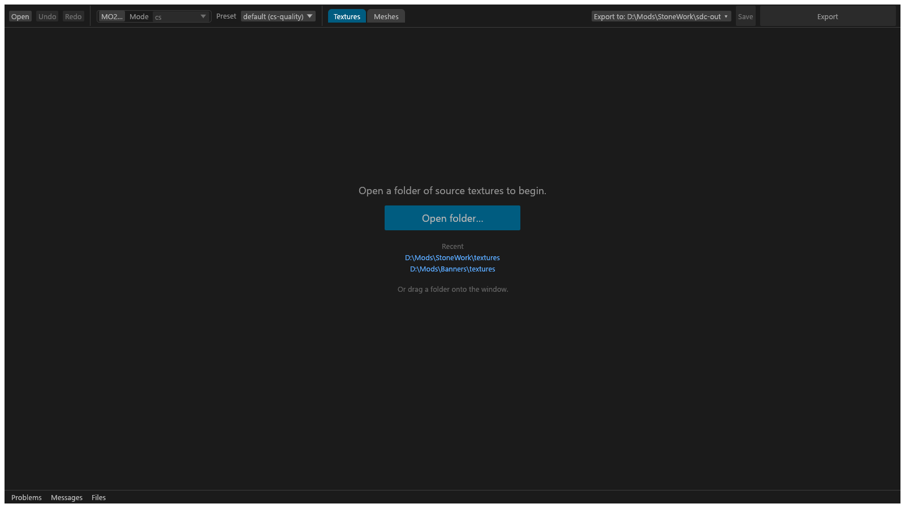
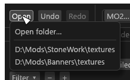
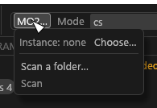
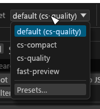
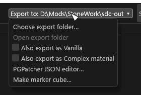

# Main window

How a folder opens, what the header holds, how the three columns are laid out, how dialogs behave, and the words the window uses. Start here if you are new to the GUI.

Tessalith (`tessalith.exe`) runs the same engine as `sdc convert`, so a folder you decide and export here converts to the same files from the command line: every decision is saved in the folder's `sdc.toml`. The window has two views, picked in the header: the Textures view (converter and set editor) and the Meshes view (mod scanning and NIF editing, see [Mod scanning](Mod-Scanning.md)).

## Opening a folder

Click **Open folder** on the start screen, or choose **Open > Open folder…** in the header. You can also pick a folder from the **Recent** list (on the start screen, or in the **Open** menu), or drag a folder onto the window; a dropped file opens the folder that holds it.

The GUI reads the folder recursively, analyses every image and plans the conversion. Nothing is written to your textures.

### The start screen

With no folder open the window shows one large **Open folder** button in the middle, under the hint "Open a folder of source textures to begin." (after a cancelled open it reads "Opening cancelled"). Under the button is the **Recent** list; click a folder to open it. "Or drag a folder onto the window." is the last line.

The Textures and Sets columns and the Advanced drawer are not drawn until a folder is open (the bottom strip is), and the column eyes in the header are hidden. The widths you dragged are kept and come back with the first folder. When a folder opens, the Textures and Sets columns and the centre fade in over a quarter of a second; they take clicks from the first frame.

### While a folder opens

The status bar shows a progress bar, "Analysing 1,234 / 5,000 files…".
- The total is the files Tessalith will plan: DDS inputs it does not re-encode and duplicate outputs are left out. Every file counts as it finishes, including files already analysed in an earlier open, so the bar fills on a re-open too. Packed outputs are assembled after the bar is full.
- Thumbnails appear when the whole plan lands, not one by one. Settings and bulk edit stay off until then. **Export** can be clicked, and starts once the plan lands.
- **Cancel** next to the bar stops the open and goes back to the folder you had open before, with its selection and undo history (its Files tab starts fresh). If there was none, the window is empty and reads "Opening cancelled". A cancelled folder you had not opened before is left out of **Recent**.
- The bar and **Cancel** show only while a folder opens. A re-plan after an edit shows its count as plain text.

### When `sdc.toml` is rejected

If the folder holds an `sdc.toml`, it is loaded. If that file cannot be parsed, or the engine rejects it (an unknown field or `allow` code in a `[files]` entry, an unknown sub-type; most out-of-range values are reported per file as `CFG-INVALID` instead), the folder is planned without it:
- a banner shows the error in words; a line that names a code (`CFG-INVALID: …`) is kept whole in the **Messages** tab;
- the GUI stays read-only (editing and **Export** are off, and the file is never written) until you fix the file and press **Reload** in the banner.

When the rejected value came from an edit in the GUI, the undo history stays: that edit is the top **Undo** step, its name followed by "(sdc.toml rejected it: …)". **Undo** takes it back and makes the file editable again.

### File and folder dialogs

The file and folder dialogs (Open folder, the export folder, MO2 instance, a folder to scan, nvcompress.exe, the shader folder, Save report) do not freeze the window while they are open. Only one is open at a time: the other dialog buttons and Open folder in the palette are greyed out ("A file dialog is already open") until you answer or cancel.
- If you open another folder while the export folder or Save report dialog is still up, its answer is ignored. A folder picked in Open folder… always opens, as the latest choice.
- **Choose export folder…** in the **Export to ▾** menu is greyed out while an export runs ("An export is running: change the folder after it ends").

## Header

The header is one row from about 1340 points of window width; in a narrower window **Export to**, **Save** and **Export** wrap onto a second line instead of overlapping. The Meshes view draws the same header, and the status line and banner under it show there too.

| Control | What it does |
|---|---|
| **Open** | A menu: **Open folder…** (pick a source folder), a separator, then your recent folders (the last ten), or a greyed "No recent folders". |
| **Undo** / **Redo** | Up to 200 steps (**Ctrl+Z**, **Ctrl+Y**); greyed out with nothing to undo; hover for the step ("Undo: Format"). The status line then says "Undid: Format." until your next edit, and the bulk panel's result line clears. Undoing back to the last save clears the unsaved dot. Redo of a **Duplicate** is refused, with the reason, when a file is at the copy's path. |
| **MO2…** | The scan source: the MO2 instance (**Choose…**), its profiles, **Scan a folder…** and **Scan** / **Cancel**. Hover for the instance and profile. Framed together with **Mode**. |
| **Mode** | The target: `cs` or `vanilla`. Saved in `sdc.toml` as `target`. Hover the menu or an entry for what each target means. |
| **Preset** | The preset the folder converts with: the Mode's default, or a built-in or user preset of this Mode. Saved in `sdc.toml` as `preset`. The preset entries are greyed out until a folder is open. Its last entry, after a separator, is **Presets…**, which opens the preset creator (see [Presets](GUI-Presets.md#presets)). |
| **Textures** / **Meshes** (tabs) | Switch views; the selected one is filled. |
| **Textures**, **Sets** (eye toggles) | Show or hide each column: an open eye shows it, a struck-through eye hides it; hover says what a click does. Right after the view tabs, Textures view with a folder open only. |
| **Export to ▾** | The export folder chosen for this project, saved in the project's `sdc-project.toml`, so each project keeps its own. See [Export to](#export-to). |
| **Save** (Ctrl+S) | Write `sdc.toml` and `sdc-project.toml`. Left of Export, as tall as the row. |
| **Export** | Convert the folder. See [Export](#export). |

### Export to

**Export to ▾** shows the export folder chosen for this project. A long path is cut in the middle so its tail stays visible; hover gives the whole path.

It is not drawn until a folder is chosen for the project: a project never takes over the folder you picked for another mod. The same menu is then a plain **More ▾**, and Review lists "No export folder chosen" with a **Choose…** button. The folder dialog opens in the app-wide folder saved in `gui.toml`, if there is one.

The menu holds:
- **Choose export folder…**;
- **Open export folder**, greyed out with the reason when the folder cannot be opened;
- the two checkable items **Also export as Vanilla** and **Also export as Complex material** (see [Also export as Vanilla and CM](GUI-Also-Export.md#also-export-as-vanilla-and-cm));
- under cs with a folder open, **PGPatcher JSON editor…** (the TruePBR JSON editor, a centre tab).

### Export

The big button at the right edge, as tall as the row.
- It reads **Review n files** in the plain button colour while anything is undecided, blocked or waiting for a tick.
- It reads **Export n files**, filled with the accent colour, once Review would write without skipping anything.
- It reads plain **Export** with no folder open.

Either way a click opens Review, or exports a clean project. While an export runs, the lower half of the button is a progress bar with done/total (hover it for the file being written; **Cancel** is in the Files tab).

### Status line and banner

The window title shows the folder, with a dot when there are unsaved edits. The line under the header is the status line: the file and set counts, a VRAM estimate for the selection and for the folder, and the progress of anything running. Under it a banner appears when something needs attention, for example an `sdc.toml` that failed to load, with a **Reload** button. On the Textures view, a scan row under the header shows the scan's progress, status and errors when there are any.

**Messages** is a tab of the bottom panel, not a header button. Its label counts the entries you have not seen. **Ctrl+M** opens it, and again collapses the panel.

## The three columns

From left to right: Textures, Sets, then the centre. The **Advanced** drawer is at the right edge, except with a set selected in 2D, where Advanced is the last tab under the set editor's slot rows. Under all of them runs the bottom panel.

- **Textures** (first): one tile per file. See [Textures column](GUI-Textures-Column.md).
- **Sets** (second): one card per material set. See [Sets column](GUI-Sets-Column.md).
- **Centre**: the settings of the selected texture, or the set editor for a selected set. See [Texture settings panel](GUI-Texture-Panel.md) and [Advanced drawer](GUI-Advanced-Drawer.md).

Each column collapses to a thin strip with the **◀** on its heading (hover *Collapse the {name} column*); **▶** expands it.

## Dialogs

Keys, button layout and every dialog's buttons are on [Dialogs](GUI-Dialogs.md).

## Words

One word for each idea, everywhere in the window. The code, where there is one, is on hover.

- **Undecided.** A texture that waits for your answer (its sub-type, what its alpha means, its cube layout, or an acknowledgement). The Textures column counts them (*n undecided*), the pill is *Undecided*, a Problems row reads *Undecided: …*, and each row's button is *Decide…*. Export skips them.
- **Not ready.** A set with a problem in the set or in one of its textures. It is the Sets column's *Not ready* pill, the opposite of *Ready*.
- **Blocker.** A problem that stops the export (a red dot). Fix it or remove the texture and export again.
- **Warning.** A problem that does not stop the export (an amber dot). Export writes the file anyway; Review asks you to tick the ones that need it.
- **Check.** A hint from an artist check (Advanced → Checks): a map that will probably look wrong in game. It never blocks and never changes "ready" (a weak grey dot).
- **Pin.** *Pin slot (sdc)* keeps a set slot's file as it is in Tessalith (saved in `sdc-project.toml`, never in the PGPatcher JSON). *Pinned* in the preview is the encode you compare against.
- **PGPatcher lock.** PGPatcher keeps the mesh's own texture in a slot ([Slot menus](GUI-Sets-Column.md#slot-menus)).
- **Field lock.** A field that the target or the sub-type fixes, so it is greyed with the reason (for example the format of a type that allows only one). Not the PGPatcher lock and not a pin.
- **Half size.** Review's answer for a texture whose full size adds almost nothing: the texture is written without its top mip, half the width and height (`drop_top_mip`). The check that asks is *Low detail*.
- **Halve if larger than 512.** The Resize option that halves a texture only when its larger side is above 512. A setting for a sub-type, not an answer to a question.
- **Set.** The textures that belong to one material: they share a name stem (and a PGPatcher JSON entry under Community Shaders).
- **Helper.** A source file that is not a texture of its own: it fills a channel of another output, or blends into the normal. It is never written as a DDS.
- **Sub-type labels.** A sub-type reads as its id with spaces (*pbr albedo*); *Skin RFAOS* is the one name spelled out. The id (`skin_rfaos`) is on hover.
- **One accent.** The window has one non-status colour (teal), for selection, the RNM outline, a slot's flash and the path lock. Red, amber and green are for status only.
