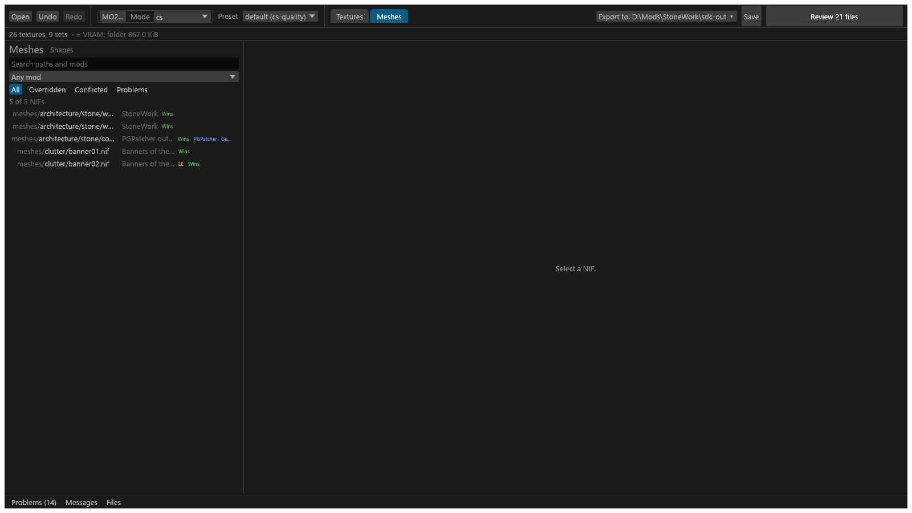
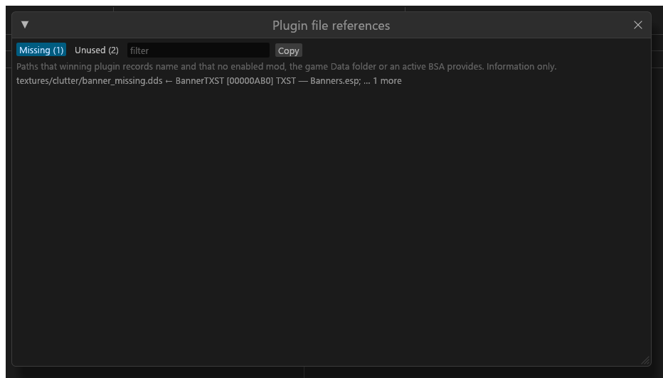

# The Meshes view

The GUI's view of the meshes a mod scan found: the mesh list, its filters, the shape cards and the 3D view. For anyone checking which meshes use a texture, or picking a mesh to edit. What a scan reads and stores is on [Mod scanning](Mod-Scanning.md); editing a mesh is on [Editing a NIF](GUI-NIF-Edit.md).

## The Meshes view

Switch to it with the **Meshes** tab in the header. The Meshes view draws the same one-row header as the Textures view (Open, Undo, Redo, MO2…, Mode, Preset, the view tabs, Export to, Save, Export) with the status line under it; only the column eyes are missing.

The scan source and the scan's progress are behind the **MO2…** header button; see [Choosing what to scan](Mod-Scanning.md#choosing-what-to-scan). The scan row's **Scan details** lists what the last scan found and any notes (missing mod folders, archive notes, meshes that failed to read).

## The mesh list

The left column lists every mesh path once, with the copy that wins in game: the path (without `meshes/`, cut to the column, full path on hover), its mod, and its chips, warnings first: **Problem**, **Stale patch** (PGPatcher patch out of date), **LE**, the edit badge, the status chip (**Wins**, **In game** for "Patched by PGPatcher (in game)", or **Overridden**), **PGPatcher**, and the mod's **Generated** (by PGPatcher), **BSA** or **game Data**. Chips that do not fit are cut; hovering the chips lists every one in full, with the copies and the problem's text. **Search paths and mods** keeps the rows whose path or mod name holds the text (ASCII case does not matter, `\` reads as `/`, a leading `meshes/` is ignored). The **Any mod** box picks one mod with meshes (PGPatcher's output mod is not offered) and lists all of its copies. The chips are *All*, *Wins* (with a mod picked only), *Overridden* (under **Any mod**, every losing copy with its own mod), *Conflicted* (more than one copy) and *Problems* (a problem or an LE mesh). With a texture folder open, a **This project N** pill comes first, on the first time that folder opens, then as you left it for that folder: when the folder is a mod of the MO2 instance it keeps every mesh with a copy in that mod, whatever wins, and such a row names the opened mod with "wins: {mod}" on hover; when it is not, it keeps the meshes that name one of the folder's output textures in a slot (a leading `textures/pbr/` is ignored on both sides). With no such mesh there is no pill. It combines with the search, the picker and the chips. A count line reads "N of M NIFs" and adds "(the selected NIF is hidden by the filters)" when it is: filters and the picker never deselect. The rows are read in the background after a scan or reload ("Reading the scan…"); with no scan the column says "No scan yet."

**Show in Meshes** under a texture's **Used by meshes** opens this view with a **Uses <texture> ✕** chip, so only the meshes that use that texture are listed ([Used by meshes](GUI-Texture-Panel.md#centre)); **✕** shows them all again. While a scan runs, or after one that did not complete, the chip waits for a completed scan before it cuts the list.

A NIF with a saved edit gets a chip: **Edit pending**, **Edited** (exported and unchanged) or **Edit conflict**.

## Mesh detail

Select a mesh to see:

- **In game** / **Source**: the copy that wins in game, or the source mod's copy of a PGPatcher-patched mesh.
- **Plugin overrides**: plugin records that use this mesh. **Show inert** includes records that have no effect.
- Override and conflict information ("Overridden by …").
- **Edit**: opens the mesh for editing ([Editing a NIF](GUI-NIF-Edit.md)).

**Plugin file references…** opens a window listing files that plugins reference: *Missing* (referenced but not found, with **Show inert**) and *Unused*, with **Copy**. The button is there whenever a scan database is open. After a folder scan, which reads no plugins, the window says "Plugins were not read in the last scan".

## Shapes

The column is titled **NIFs** (**Meshes** is the view tab), and next to the title is a **Shapes of <file>** button (plain **Shapes**, greyed out, "Select a mesh first", until a mesh is selected). Switched on, it replaces the mesh list with the shape cards of the selected mesh; switched off, or when the selection clears, the list is back. While **Edit** is open the column stays on the shapes and the button is greyed ("Close Edit to see the mesh list"): the cards are where you pick the shape to edit. The right-hand pane always shows the 3D view; the title, warnings and In game / Source toggle above its frame scroll when the window is short, so the frame keeps at least 160 px. The column starts at 420 px and is at most 40% of the window, narrowing further as needed so the 3D view keeps at least 240 px (with the edit panel open too); its lists have thin scroll bars that stay visible. Closing Edit puts the column back on what it showed before (Edit keeps it on Shapes).

Each shape is a framed card. It shows, from the top:

- **#N name**, with the block type on the right, a button as wide as the card. N is the shape's PGPatcher 3D index, the number plugins use for its alternate textures (a shape outside the scene tree reads `#–`). Click it to select the card: it gets the accent outline, and **Edit** then opens on that shape instead of Root. A NIF with one shape opens on it. Hover for the NIF block index ("NIF block 12").
- **The shader**, in bold: the lighting shader type, for example **Hair Tint (6)**, or "Effect shader".
- **The textures**: each set slot with its path, indented, and one weak line for the empty ones ("(4 empty slots)"). Slots count from 1, as in the set editor ("slot 1 (diffuse)"); hovering a slot's name gives the NIF's own index ("NIF texture index 0"). A missing texture says "→ missing" in red.
- **Alpha**, in words: "Alpha: blend Src Alpha → Inv Src Alpha · test Greater, threshold 5". Blending or testing is left out when it is off, and "Alpha: none" shows when both are. A shape with no alpha property says "No NiAlphaProperty". Hover for the raw flags, for example "flags 0x12ED (4845)".
- **Controllers**: how many, and their names, with "(clip)" for one a clip drives, for example "2: Emissive multiple, Alpha (clip)", or "none". A shape with an effect shader lists only its alpha controllers (the editor does not read the effect shader's), and has no line when it has none. Outside Edit the line is read from the NIF file once per scanned copy (it appears a moment after the cards; a file that no longer reads simply shows no line); inside Edit it follows the edited file, unsaved edits included.
- **Details**, closed: the NIF block and 3D index, **SLSF1 0x…** and **SLSF2 0x…** (open one to list its set flags by name, for example "Specular (0)"; a bit with no known name reads "bit N"), the geometry line (skinned, vertices, triangles), which mod each texture comes from ("→ A (2 copies)") and the raw slot strings.

A texture path that is a texture of the open folder has an **Open in Textures** button, on the shape card and on the "Users of" list's title. It switches to the Textures view, selects that texture and scrolls it into view.
