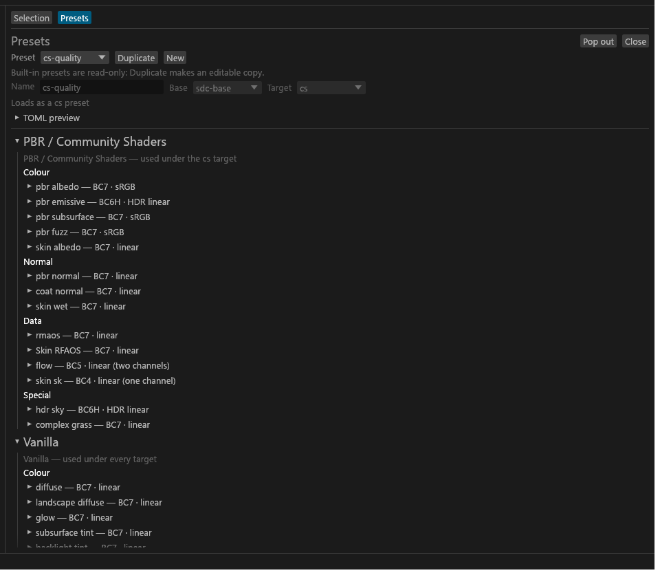

# Presets

The preset creator: how to make, edit and save your own presets from the GUI. For anyone who wants different defaults for a kind of texture across many folders. What a preset is, and the built-in ones, are in [Presets and targets](Presets-and-Targets.md).

## Presets

**Presets…** (the last entry of the Preset combo in the header, or *Open the preset creator* in the command palette) opens the preset creator as a tab of the centre column. While Presets or the JSON editor is docked there, a row of tabs over the centre (**Selection**, **Presets**, **TruePBR JSON**) picks what the centre shows; clicking a texture or set (also the one already selected), or expanding a preview, brings **Selection** back to the front. While one of those tabs is in front the **Advanced** drawer is hidden (it comes back with **Selection**), and the grid and Sets keys wait too, so a key does not change the selection from under the tab. On the view's heading row, **Pop out** shows it in a window of its own (for a second monitor), **Dock** puts it back in the centre, and **Close** closes it, as does closing its window. Opened from the Meshes view, a docked view switches to the Textures view, which has the centre column. Nothing about it is saved in `gui.toml`. It edits your own presets, the files in `%APPDATA%\sdc\presets\` that the command line also loads.

- **The top bar.** Pick a preset. The built-in ones are read-only and show no error; of the editing buttons they offer only **Duplicate**, which makes an editable copy (named `<id>-copy`, without the original's suffix aliases); **New** starts an empty preset on the current target's quality preset. **Name** is the preset's id and file name (lower-case letters, digits and `-`); **Base** is the preset it builds on; **Target** is cs, vanilla, or "from the base". **Save preset**, **Revert**, **Reset preset** (drops every per-sub-type and suffix-branch change, so the base shows through) and **Delete…** (after a confirmation) are for your own presets only. The line beside them says whether the preset loads, or why not, in the engine's own words. **TOML preview** shows exactly what Save writes. If the preset's file changed on disk since you picked it (you edited it by hand), Save does not write: it asks **Overwrite** (write your version over the file), **Reload** (drop your changes and load the file) or **Cancel**. If the file was deleted or no longer loads, Reload keeps your edits and says so; Overwrite then writes them back to the same file. Picking another preset, New or Duplicate while you have unsaved changes asks first. Preset files in the folder that did not load are listed at the top of the view with the reason, and **Open folder** opens the folder.
- **The sub-types.** One row per sub-type, in two families: **PBR / Community Shaders** (the sub-types only the cs target has: PBR, coat, Advanced skin, flow, HDR sky; and complex grass), then **Vanilla** (everything vanilla also has, including glow, envmask and complex_material). Complex grass is under PBR / Community Shaders: both targets have it, but it is a Community Shaders feature. Inside a family the rows are grouped Colour, Normal, Data and Special, where it has them. A row's title shows its format; open it for:
  - **Suffixes**: one branch per suffix that names the sub-type: the built-in suffixes, then your aliases for them (`_bumpy` for `_n`, say). The row's own settings below are the "no suffix" default; a branch changes them for the files with that suffix only. Open a branch (its title shows its format and how many fields it overrides, e.g. `_d — BC7 · sRGB (overrides 2)`) for the same Compression, Resize & mips, Alpha, Channel remap and Packing fills as the row, each hinting what the files get without the branch ("inherits"), with **↺** to drop the change. The title's format is what a file with that suffix gets from the whole preset, its other rules and, for an alias, the canonical suffix's branch included; "(+ rules by alpha)" marks a branch that a rule on alpha content may also change. A branch with no changes writes nothing. A branch is saved as one rule: `match = { suffix = "d", subtypes = ["diffuse"] }` for a built-in suffix, `match = { glob = "*_<alias>.*", subtypes = [...] }` for an alias. Every matching rule applies, in order, each changing only the fields it sets, so branches are written after your other rules (built-in suffixes, then aliases): a branch changes only its own fields on top of them, and an alias branch adds to its canonical suffix's branch. Rules the creator did not write are listed under **Other rules** (read-only) and kept as they are. A `[files]` value or `--set` still beats a branch. **Add alias** adds the alias and opens its empty branch; **Remove alias** removes it with its branch. The rmaos row shows the built-in ORM → RMAOS packing as a read-only `_orm` branch (it needs no preset). A new alias is checked as you type, with the engine's message when it is refused (not lower-case letters and digits, a built-in suffix, an exporter term such as `orm`, or an alias another preset already declares).
  - **Compression**: format (only the formats and tags the engine allows for the sub-type and target), encoder and effort.
  - **Resize & mips**: resize, mip levels, mip filter, and coverage for the cutout policies.
  - **Alpha**: policy, and the threshold for cutout; shown where the format keeps alpha.
  - **Channel remap** (data sub-types): the channel swizzle, the source of R, G, B and A (r, g, b, a, 0 or 1), saved as `channels.swizzle`. A remap for an alias's files is the Channel remap of that alias's branch.
  - **Packing fills** (data sub-types): the values for packed channels without a source map (roughness, metallic, AO, specular, height, 0-255).
- Each field shows the base's value as a hint (in a branch, the sub-type's). A field you changed has **↺**, which removes your change. A sub-type's category, colour space and the other built-in rules are never offered.
## Saving

The preset is loaded through the same loader as the presets folder before the file is written; a preset that would not load is never written. Your preset goes back to its own file, edited in place so its comments and layout stay; a new one goes to `<name>.toml`. After a save the folder is read again, the preset is listed in the header's **Preset** menu and the folder is planned again, without a restart. If `sdc.toml` names a preset that has since been deleted, the folder is still planned with the fallback (your config's preset, else the Mode's default) so the window is not empty, but the export is blocked: Problems shows a red row "Preset <id> is not installed" with **Choose preset…**, which opens the header's **Preset** menu. `sdc convert` stops on the same file with exit code 2.
