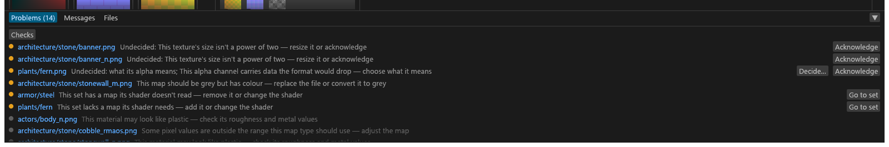

# Problems

The bottom panel's **Problems** tab: one row per thing that needs your attention, each with its fix as a button. For anyone getting a folder ready to export. What each code means is in [Diagnostic codes](Diagnostic-Codes.md).

## Problems

Rows come blockers first, then undecided textures, then warnings, then checks and info rows. A coloured dot starts each row: red blocks the export, orange is a warning or a decision to make, grey is a check or an info row.

Then come where it is (a texture, set or file you can click; "Project" for a problem that belongs to no file) and a sentence that names the action ("This alpha channel carries data the format would drop — choose what it means"). A row never prints a code: hover the sentence for the engine's own message and the code (`LOSS-ALPHA-DATA`), which is also what Troubleshooting and the `--allow` lists use. A problem with no sentence of its own shows the engine's message.

A row is one line and does not wrap. The fix buttons sit at the panel's right edge and stay visible, and a sentence too long for the room left ends in an ellipsis.

| Row | Fix in the row |
|---|---|
| A blocker the export would stop on, for example a set that matches nothing | Its own button, or **Go to set**. |
| *Failed: …*, a texture that failed to plan | — |
| *Undecided: sub-type; what its alpha means; <the warning's sentence>* | The [type buttons](#deciding-in-problems), **Decide…** (the alpha choices) and **Acknowledge**. A question that is an acknowledgement shows its warning's sentence, for example "This texture's size isn't a power of two — resize it or acknowledge". |
| Export pitfalls, texture and set warnings | **Go to set** on a set's row. |
| A file's export warnings, once the export has ended | Click the file to select it. |
| Artist-check warnings ([Artist checks](GUI-Artist-Checks.md)) | A grey **check** dot that does not change "ready". A **Checks** pill narrows the list to them. |
| Info rows, last, with a grey **info** dot | **Undo this change** while that step is still the last one. <!-- D:FC3 --> |

Info rows never count against "ready", but the tab's number counts every row shown, these included. Each is something Tessalith changed for you that you may want back: a packing fill dropped because a helper now fills the channel, a format or tag reset when a texture's type changed, the types it set automatically. A `_curves`, `_curvature` or `_cavity` map no recipe reads is an info row too, with no button: "Read only by Also export; not written on its own".

Each entry of the **Decide…** menu has a hover that says what it does; the same lines are on the alpha buttons in Review and in a texture's settings.

### What the GUI writes on its own

When a plan settles, every sub-type it took from a High-confidence suggestion (including a type the scanned meshes or a GRAS grass model gave it) and every alpha meaning it took from the meshes is written to `sdc.toml` as a `[files]` entry, as if you had chosen it.

- It is one undo step, `Set {n} types automatically`, and one Info row in Problems, "{n} types set automatically (High confidence)", with **Undo this change** and the list of textures on hover. Both say *values* instead of *types* when an alpha meaning is among them.
- The project then has unsaved changes. Save keeps them (its hover says so while they are the only ones), and `sdc convert` reads the same types without `--accept-suggestions high` and without the scan. These automatic types alone do not count as your edits: the window title shows no dot, and closing the window, opening another folder or Reload does not ask; the next plan records the same types again. Until you save, `sdc convert` on that folder does not see them. Any later Save writes them with your edits.
- A file you already gave a sub-type or alpha policy is never touched. An Undo of the step stays undone until the folder is opened again.
- A written type is a value of the project: it reads as a set value, without **(auto)**, and a later scan does not change it (the scan's view shows as a suggestion).
- While it is still the type Tessalith would pick by itself, these re-type it: a set shader you pick (written to the project too, since `sdc convert` does not read set shaders) or going back to Auto, deciding a set's diffuse as a PBR albedo (its members follow), or a new preset alias. A type you changed is kept. The writing is always an undo step of its own, also when an edit of yours led to it.
- Two decisions stay in the GUI only: a mesh *Remove* (written out, it would change the format the compact presets pick), and the environment-map `_m` that Also export derives from the meshes (`sdc convert` writes no `_m`).

## Deciding in Problems

An undecided texture with a suggested type shows it as one button, **Set type: subsurface tint ✓** (a click decides it), with **▾** beside it for the type picker. With no suggestion there is a plain **Set type…** that opens the picker.

- The type picker opens at its button: the suggestion first, marked *(suggested)*, a search box that has the keyboard (type `tint` to list only the types with "tint" in their name), and the grouped list below it, which scrolls. Esc closes it and does nothing else.
- **Accept all suggestions (n)** at the top of the list decides every texture that has a suggestion, as one undo step.
- A row takes the keyboard (Tab, or Shift+Tab back). **Enter** or **Space** on a row with a suggestion accepts it and moves to the next row; on the last row the keyboard stays on the list. A row without a suggestion ignores both.
- Every accept edits the project in memory, like any other edit: **Save** writes it to `sdc.toml`.
- These buttons are greyed out, with the reason on hover, while `sdc.toml` is read-only ("Wait for the plan to finish" while a plan runs).

## Every row has its action

A row you must act on never just reports; its fix is its button:

| Row | Button |
|---|---|
| *No file matches …* (a set line that names no file, the card's red **?** chip) | **Remove from set** or **Delete set** ([Set cards](GUI-Sets-Column.md#set-cards)). |
| A stale generated map (`GEN-STALE`) | **Regenerate…**, which opens the generate dialog with that map ticked and writes nothing until you press Generate there. |
| A short normal (`CHAN-NORMAL-LENGTH`) | **Rebuild Z**, which sets the file's `channels.reconstruct_z`; greyed with "Rebuild Z is on for this file: export again to rewrite it" once it is set. |
| A folder that could not be read | A Project row with **Open folder**. |
| The Vanilla/CM derive results ("no envmap", "NIF suggests …") | **Open report**, or **Show in Messages** when no report was written. |
| An unclear cubemap layout | **Set layout ▾**. |
| A PGPatcher feature clash | **Turn {feature} off**. |
| A PGPatcher path error | **Fix path**, which selects the set and puts the keyboard in that field (a `rename` or match path). A slot path error has **Go to set** instead, because slot paths are edited in the JSON editor. |
| A NIF problem from the Meshes view | **Open the {tab} tab**, with the edit panel's own tab name (*Shader*, *Alpha*, *Controllers*, *Extra data*). |
| *sdc-project.toml cannot be read: TOML parse error at line n…* | A red Project row (the parser's whole message on hover) with **Open in editor**, which opens the file with Windows' default program for it, and **Reload**, which reads both files again (it asks first when something is unsaved). Sets and the JSON stay read-only until the file is fixed, and the banner says why. |
| *sdc.toml is read-only: changes cannot be saved* (or `sdc-project.toml`), when a save is refused because the file has Windows' read-only flag | **Clear read-only flag**, on that file only. With nothing unsaved the files are then reloaded; with unsaved edits they are kept, and the status line says to Save. <!-- D:FC10 --> |
| *also.json cannot be read* (the Also export's record, `<PBR folder>\_sdc\also.json`) | **Reset also.json**, outlined in red: it deletes that file only. The manifests do not list the report, zips or sums file, so nothing rebuilds the record: the next Also export writes a new one, and each report, zip or sums file already there counts as one Tessalith did not write. That export keeps each one and says so; delete them to have them written again. <!-- D:FC10 --> |
| *Preset {id} was skipped: it clashes with {other} on aliases* | **Remove aliases from {id}** ([below](#skipped-presets)). |
| *Looks like complex grass, but is not tagged as grass* (Info: a diffuse with the 1:2 complex-grass shape and a normal-map bottom half that no grass record of a scan names) | **Tag as grass**, which writes `subtype = "complex_grass"`. <!-- D:FC10 --> |
| *Colour divided by alpha on load (premultiplied EXR)* (Info: an OpenEXR source with partial alpha) | **Straight alpha**, which writes `alpha.exr_straight = true`. An OpenEXR source's settings have the same **Straight alpha** in the Alpha group. <!-- D:FC10 --> |
| *matchN is empty and matches nothing* (Info: a set's stored `matchN = ""`, N from 2) | **Remove match**, which removes the key. |
| *Preset <id> is not installed* (red) | **Choose preset…**, which opens the header's **Preset** menu ([Presets](GUI-Presets.md#saving)). |

A set row keeps **Go to set** beside its fix. These buttons act only on their own click: Enter and Space never run them, and they are greyed while a plan runs or while the file they write is read-only.

### Skipped presets

*Preset {id} was skipped: it clashes with {other} on aliases* is a user preset skipped because another preset, which loaded first, already declares its suffix aliases (for example a copy made by hand). Files load in name order, so the skipped one can be the original: `mine-export.toml` loads before `mine.toml`. **Remove aliases from {id}** deletes the `[suffix_aliases]` table of the skipped preset's file (its hover names the file), keeping its comments and other keys, and plans again so the preset loads. It is greyed while an export runs.

## Narrowing the list

A click on a texture, set or file switches to the Textures view and selects it.

The list opens narrowed when you arrive from a count: **N undecided** at the foot of the Textures column (*Undecided only ×*), a set's **⚠** badge, or the set editor's "N problems in this set — Show in Problems" line (*Set: name ×*). Click the chip to see everything. The **Checks** pill narrows to check rows (click again to see everything); with a set filter on, it narrows to that set's check rows and keeps the set.

A green dot marks what is ready: a texture tile or a set with nothing to decide. The header **Export** button's own states are on [Review and Export](GUI-Review-and-Export.md#export).
