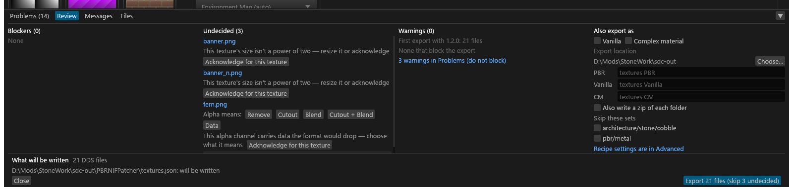

# Review and Export

What **Export** does, the Review panel that opens when something needs a look first, and the Files tab that shows an export's progress. For anyone exporting a folder.

## Export

**Export** converts the folder into the export folder (**Export to ▾** in the header; see [Export to](GUI-Main-Window.md#export-to) for how the folder is chosen and where it is saved). It cannot write into the folder it reads, and Review blocks the export until a folder is chosen ("No export folder chosen"). With an `sdc-project.toml` that does not parse, the chosen folder goes to `gui.toml` instead.

1. Export saves `sdc.toml` and `sdc-project.toml` first.
2. When something needs an answer, [Review](#review) opens in the bottom panel instead of exporting.
3. If a source file changed on disk since it was planned, the textures concerned show "changed on disk" and the Textures column offers **Reload**, which plans again, re-reading only the changed files. Export checks first and plans again by itself, so the export uses current files. The GUI also checks whenever its window regains focus.
4. The bottom panel opens on its [Files tab](#the-files-tab).
5. After a complete export, the PGPatcher JSON is written ([The JSON file](GUI-PGPatcher-JSON.md#the-json-file)). NIF edits are written after the textures ([NIF edits](#review)).

**The header button.** **Export** reads "Review n files" in the plain button colour until the project is clean (a folder chosen, files to write, planning finished, nothing undecided), then "Export n files" in the accent colour. With no folder open it reads plain "Export". Hover it for "N files, M problems" and what Review still has open.

**Copy CLI command** (Files tab) copies the `sdc convert` command that reproduces this export from the command line: the same folder (with `--recursive`), output, BC1 decoder and thread count, and `--accept-suggestions high`, as the GUI plans. Because Export saved `sdc.toml` first, that command gives the same manifest records and the same DDS bytes for everything `sdc.toml` decides. Check two things it does not carry over:

- It has no `--nvtt`. If you chose an NVTT path in Advanced, add `--nvtt <path>`.
- The CLI reads neither `sdc-project.toml` nor the scan. Set edits (moved files, created sets, borrows, set renames, output names, set shaders) and the mesh and grass evidence from the scan do not apply to `sdc convert`, so sets that depend on them come out differently. The sub-types and alpha meanings that evidence decided are written to `sdc.toml`, so those carry over.

The hash of each JSON Tessalith writes is recorded at once in `_sdc/generated.json` beside `sdc-project.toml`, so discarding unsaved edits after an export, a crash, or a read-only `sdc-project.toml` does not make the next export ask about Tessalith's own JSON.

With [Also export as Vanilla and CM](GUI-Also-Export.md) on, Export always opens Review, and Review's Export writes three folders.

## Review

Press **Export**: a clean project exports at once, but when something is blocked, undecided or worth a second look, Review opens in the bottom panel instead of a dialog. It opens for any of these: a blocker, an undecided texture, an export pitfall, a half-size question ([Artist checks](GUI-Artist-Checks.md#half-size)), a PGPatcher JSON edited outside Tessalith, or NIF edits waiting to be exported (Review's **Export** is the only way they are written).

- Review does not lock the window. Keep editing and its lists update; Export from Review always uses the plan current at that moment.
- Review never exports by itself, not even when you decide the last texture: its **Export** button is the only way out. Enter does nothing there.
- When Export becomes available, the button (in Review and in the header) fades to the accent colour over 0.15 s, and the header's "Review n files" turns into "Export n files"; losing it snaps back at once.
- **Size.** Review opens at 40 % of the window's height, worked out once, when Review first opens; drag its top edge to change that, and Tessalith remembers your height for Review. Review and Problems keep separate heights, so the tab strip moves when you switch between them. Under 1200 points of window width the sections stack in one scrolling column (Blockers, Undecided, Warnings, then Also export as when it shows) instead of sitting side by side. Review's columns draw a thin scroll bar.

Each column's heading carries its count: **Blockers (n)**, **Undecided (n)**, **Warnings (n)**.

- **Blockers** (red), with **Go to set**. A missing export folder is a blocker, so it counts. Export stays greyed out, with the reason beside it ("Fix 2 blockers first"), until they are fixed.
- **Undecided**: one row per texture with its question: a sub-type box and **✓**, the alpha choices, or **Acknowledge for this texture**. Click the name to select the texture. **Accept all suggestions** works as in [Problems](GUI-Problems.md#deciding-in-problems); the others stay listed. A texture decided here leaves the list. Below them come the [half-size rows](GUI-Artist-Checks.md#half-size).
- **Warnings**: what re-encodes after an upgrade, then pitfalls grouped by set.
  - After a Tessalith upgrade, one row per reason files re-encode (`2 files re-encode: the normal encoder changed in 1.1.0`, `their settings changed`, `new output type`), compared with what the older version recorded. An export folder with no manifest shows a plain line, `First export with 1.1.0: 20 files`, that asks nothing. The rows go when the export starts.
  - Tick each one to say you have seen it, or press **Acknowledge all**. Export stays greyed out ("Acknowledge 2 warnings first") until every current pitfall is ticked. Ticks count for this export only: they are not saved, they go when the export starts or Review closes, and a changed or new pitfall needs a new tick.
  - With no pitfall to tick the column reads "None that block the export"; "N warnings in Problems (do not block)" opens the rest.

**Overwrite questions** (in Blockers): a PGPatcher JSON edited outside Tessalith ("<name> was edited outside Tessalith") and a NIF whose export path holds a file Tessalith did not write ("<path> was not written by Tessalith") each have **Keep the edited file** or **Overwrite it**. Neither is chosen until you click, and Review's **Export** stays off ("Answer Keep or Overwrite for <name>") until every one is answered. The answer is tied to the file as it is now: a change to the file before you press Export is asked again; a change during the export is kept, with a note. The answer applies to the next export only; closing Review or a reload clears it. The Community Shaders PBR and complex-material JSON show their state only; a file of those edited outside Tessalith is kept, with a note.

**What will be written**: the number of DDS files and one line per JSON file with its state on disk: *will be written*, *will be replaced (written by Tessalith)*, *edited outside Tessalith* or *cannot be read; kept*.

**NIF edits (n)**, at the top of the footer, lists each NIF with pending edits: `path · mod · n unused blocks removed · written to <export folder>`. A NIF edit that cannot be exported is a warning instead: "NIF edit skipped: <reason>" in amber in the Warnings column, counted in its number; it never holds back the textures. The NIF edits are written once the texture export (and, with Also on, its zips) has ended; a cancelled export writes none. The result is a line in Messages and in the export notes.

**Stale outputs (n)**, under the NIF edits: the files an earlier export wrote into the export folder that this project no longer writes, from its manifest. That covers a renamed set's old files, a skin set's old `_f.dds` or its old files under `textures\pbr\`, the old `_rmaos.dds` after a recipe switch, and the output of a source you deleted.

- Each row is `path · no longer written` (or `· its source is gone`). A file that still has the size and time Tessalith recorded when it wrote it has **Delete** (red outline). A file changed since, or one written before Tessalith recorded those, reads `edited since Tessalith wrote it: left alone` and has no button.
- **Delete** acts on a mouse click only, never on Enter or Space, never on Export, and not while an export runs. It checks the file again when you click, and a file changed in the meantime is left alone.
- Old JSON files Tessalith wrote are listed too (a PGPatcher JSON under an earlier name, a Community Shaders PBR JSON no block binds, a complex-material JSON no set writes): one still matching the hash Tessalith recorded has **Delete**, an edited one is left alone.
- The rows never block Export, ask nothing and do not open Review by themselves. While any has **Delete**, Problems shows the Info row "*n* old outputs Tessalith wrote are no longer exported" with **Review…**, which opens Review.

**Export 20 files (skip 2 undecided)** exports the decided textures and skips the rest; it never decides for you. **Close** closes Review and cancels an Export it had queued.

If a source changed on disk or a plan is still running, a click on Export waits for the plan and then checks again; a new pitfall in the meantime stops the export and says why in Review. Opening another folder or reloading closes Review and exports nothing. If the plan fails, Review stays open with its blockers.

## The Files tab

The **Files** tab of the bottom panel opens when Export starts. One row per file, with its state: queued, running, converted, validation failed, up to date, skipped, failed, cancelled.

- While the export runs, its line reads *done/total · elapsed · files/s · ETA*. The bar glides to each new count over 0.3 s; the text is the exact count. Files per second is the average of the last 10 seconds, and the ETA appears once 3 files have finished or 2 seconds have passed.
- The list handles thousands of files: only the rows on screen are drawn. **Failed only** (failed, or failed validation) and **Has warnings** narrow it; together they show the files that match both. Click a row to select that texture. **Show in Explorer** on a row selects the written output once it exists, otherwise the source file.
- A file's export warnings show when you hover its row, and the **Problems** tab lists them, once the export has ended, as rows that select the file.
- **Cancel** stops the batch. **Save report…** writes the report (JSON Lines or Markdown) in the background and says "Saved report: <path>" (or why it failed) in the status line and a toast. **Copy CLI command** copies the matching `sdc` command ([above](#export)). **Open export folder** opens the export folder in Explorer (greyed out, with the reason, until Export has created it). **Close** collapses the panel.
- What the export did besides converting (a JSON written, not written or kept, the borrowed-slot copies, files left in place) is listed under **Notes**, a collapsible list that scrolls when it is long. The Markdown report has the same lines under *Notes*; the JSON Lines report stays the engine's event stream.
- When Export ends, one Info line counts the artist-check warnings ("Checks: 3 warnings on 1 texture and 1 set; see Problems").
