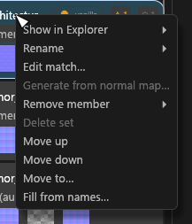
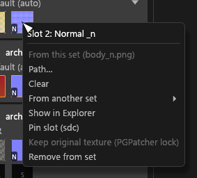
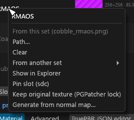

# Sets column

The second column of the Textures view: one card per material set, its filter, and how to move textures between sets, reorder and delete them. For anyone grouping a mod's textures into materials. Selecting a set opens the set editor in the centre.

## Sets (between Textures and the centre)

Textures are grouped into material sets, one **card** per set. The column is editable: it changes which textures belong to which set.

## Set cards

A card's first row has:

- the set's **position number**: its place in the full order, 1 to N, in plain digits (a filter never renumbers it);
- the **≡** reorder handle;
- the set's name;
- a status **pill**: a dot plus what the set is ("vanilla", "PBR → JSON", "PBR Landscape" or "skin"). The dot is red when the set blocks export, amber when it is not ready, green when it is ready. Every set has one, including a set you created that has no key yet;
- at the right, "⚠ n" when the set has problems. It opens the set's problems.

Hover the pill for the long text: what the set writes ("PBR Landscape → CS + PGPatcher JSON", "→ CS JSON", "→ PGPatcher JSON (no CS records yet)", "PBR Landscape (no JSON yet)"), a file with no match, a blocking problem, and the recipe status (run, conflict, disabled, failed) of each packed output.

The **shader** combo under the first row takes the card's whole width. Under it is one **slot chip** per slot of the shader, lettered by the slot's suffix (D, N, RMAOS, P, G, SK, CNR, F, S):

| Chip | Meaning |
|---|---|
| Thumbnail with the letter | A filled slot: the member's 32-point thumbnail. Click selects, double-click expands, drag moves it, right-click opens the [slot menu](#slot-menus). |
| Dim box with the letter | An empty slot. |
| Amber outline | Borrowed from another set (hover says which). It cannot be dragged out. |
| Red **?** | A file the set expects that no file matches. |

Right-click a **?** chip for **Remove from set**: it takes that line (an `add`/`remove` path or a borrow) out of `sdc-project.toml` as one undo step. When none of the set's files is left it offers **Delete set** instead. Each such line is also a row in Problems with the same button. A member's own chip has **Remove from set** in its menu too; a borrowed chip uses the slot's **Clear**. While `sdc-project.toml` is read-only they are off, and their hover says why.

Members in no slot follow as plain thumbnails. The open set's card is highlighted. A set you just moved keeps a bright outline for about a third of a second, then it fades out.

In a narrow Sets column (a card narrower than 150 points) the pill and "⚠ n" move to a second row.

The column lays out only the cards on screen, so it stays smooth with hundreds of sets. The cost:

- a card scrolled out of view is not reached by Tab or a screen reader (Ctrl+K *Go to set* and **Move to…** still reach every set);
- a context menu or shader list open on a card closes when the card scrolls away;
- the scroll bar's thumb changes length as card heights are learned;
- *Go to set* on a far set jumps to it instead of gliding.

## Filter

Under the heading:

- a *Search sets* box. It matches the set's id or its label (folded like set ids), never its key;
- the pills *Not ready n*, *Ready n* and *No JSON n*. *Not ready* is every set that is not ready, so Not ready and Ready together count every set. *No JSON* is a set that writes no JSON;
- **Filter ▾**, which lists *Any* and the shaders. It reads **Filter (1) ▾** while one is chosen.

The filters combine. A filter only hides: the open set and a multi-selection stay selected, the editor and the bulk panel stay, and the heading says "2 selected (1 hidden by filter)".

- **Go to set** from the Problems tab on a hidden set selects it and leaves the filter on. A line under the filter then says "{id} is hidden by the Sets filter", with a **Clear filter** button.
- When nothing matches, the column says "No sets match the filter (n hidden)" and offers **Clear filter**.
- Dragging and **Move up** / **Move down** are off while any Sets filter is on: the handle and the two entries are greyed out ("Clear the filter to reorder sets, or use Move to…"). **Move to…** stays on, because it names the target number, and it counts a hidden set it passes.
- A set you create while a filter is on stays shown until the filter changes; the column says "1 new set shown".

The pills and the shader are remembered in `gui.toml` with the window layout. The search text is not.

## Editing sets

- **Drag a texture** from the Textures column onto a set to move it there, or onto empty space to start a new set. Dropping onto a slot that already holds a texture asks **Replace** or **Cancel**. While you drag, a small thumbnail follows the pointer and the tile you took dims; tiles and member chips outline on hover, and more strongly while pressed.
- **Drop a file from Explorer** on a slot row of the set editor to fill that slot, when the file is a texture of the open folder and its sub-type fits. Files are never copied.
- **Share** lets a set borrow a texture from another set; **Duplicate** copies it into the set. Both ask before replacing a filled slot. A shared `_rmaos` is never variance-baked ([Variance bake](Texture-Packing.md#variance-bake)).
- **Reorder** by dragging the **≡** handle, or with **Move up** / **Move down** in the set's menu. A drag reaches only the cards on screen: the wheel does not scroll during a drag, and the edge does not scroll by itself. For a long move use **Move to…** ([below](#move-to)).
- **Right-click** a set for its menu: a **Rename** submenu, **Edit match…**, **Remove member**, **Delete set**, **Move up**, **Move down** and **Move to…**, plus share and duplicate. Right-clicking a member that fills a slot opens that [slot's menu](#slot-menus) instead.
  - The **Rename** submenu has **Rename…** (the set's name), **Rename outputs…** (F2; the files the set writes) and **Rename inputs…** (read the source files under other names). Each has a hover line and opens a dialog; see [Renaming](GUI-Bulk-and-Rename.md#renaming).
  - **Delete set** asks nothing. It is one undo step, and a toast "Deleted set name (N members)" has an **Undo** button, which works while nothing else was done since (otherwise use Undo in the header). The textures stay; only the set is removed. Only a set you created can be deleted: an automatic set would regroup from the file names at once. A set whose files are all gone still shows, as missing, so you can delete its entry.
- **Fill from names…** in a set's menu finds the textures in the set's folder that are named like its diffuse (or the set) plus a suffix the engine knows (`_n`, `_p`, `_g`, `_rmaos`, `_cnr`, `_s`, …, and exporter tails such as `_normal`) and are not in the set yet. A dialog lists each file with the slot it would fill, all ticked. A filled slot says "replaces <file>"; a pinned slot says "locked" and cannot be ticked. **Fill** (or **Enter**) moves the ticked files in as one undo step. **Esc** or **Cancel** closes it; a click outside does nothing.

### Move to

**Move to…** in the set's right-click menu opens a dialog with a box ("Number or name"):

- Type a position, and the list shows that one set. Type text, and it lists the sets whose name or label holds it, in order.
- Up and Down move the highlight. Enter or a click moves the set to the highlighted row's place; moving down takes the target's place, and the target shifts up one. Esc or **Cancel** closes.
- A number outside 1 to N says "Positions are 1 to N", and text that matches nothing says "Nothing matches"; Enter then does nothing, so a miss is never a silent move. A number is only a position, never part of a name.
- Picking the set's own place closes the dialog and changes nothing. A set a filter hides shows "(hidden by filter)".

The moved set scrolls into view and keeps the selection.

## Slot menus

Right-clicking a slot row in the set editor, or a member chip on a card, opens a menu for that slot:

- The slot commands *From this set*, *Path* and *Clear*. Each is one undo step.
- *From another set*: links the slot to a map of another set. The link writes that map's output path when it has one (a TruePBR set's packed output), otherwise the `textures\...` path its export writes (the source's folder with the output's name, so `leaf_normal.png` links as `leaf_n.dds`). A map with neither is greyed out, so a link never points at nothing. A link needs the same slot kind, so the shared slots (glow / skin_sk, coat / fuzz) never offer the other kind.
- *Pin slot (sdc)* / *Unpin slot (sdc)*. A pinned slot shows a lock icon and keeps its fill in Tessalith; the Slot commands window has a box per slot named *Pin slot N (always use this file)*, with "locked" on hover.
  - It refuses a drag in or out and the slot commands. Bulk edits skip it with the reason *slot locked*, or *slot locked in <set>* when the fill is borrowed from another set.
  - Automatic re-typing leaves it alone (Tessalith writes no sub-type into it). You can still change the texture's sub-type by hand.
  - Pinning the Diffuse slot of an Advanced Skin set also stops the automatic Advanced Skin reading: the diffuse, and packing, read as they would without that shader, unless its sub-type is already written as `skin_albedo`.
  - Pinning or unpinning re-plans, so the cards update. The pin is saved in `sdc-project.toml` and is never written to the PGPatcher JSON.
- *Keep original texture (PGPatcher lock)* / *Stop keeping original texture (PGPatcher lock)*, on a set that writes a PGPatcher entry (a TruePBR set under Community Shaders). It turns the slot's PGPatcher lock key on or off (`lock_diffuse`, `lock_normal`, `lock_emissive`, `lock_parallax`, `lock_rmaos`, `lock_cnr`, `lock_subsurface`), the same key as in the Texture locks group, as one undo step. PGPatcher then leaves the mesh's own texture in that slot.
  - The card shows a grey padlock over the dimmed thumbnail, captioned *kept by PGPatcher*. Its hover says "Kept by PGPatcher (lock_<slot>): the mesh's original texture is used here" and, with a mod scan, lists the textures the set's meshes have in that slot ("…" until it is read; read again after a scan). The member thumbnail shows a small grey padlock.
  - On a set that writes no PGPatcher entry, a stored lock key shows "lock stored, not written (no PGPatcher entry)".
  - The file is still exported, and Tessalith stops writing its own path for that slot. A slot command (`slotN`) on the same slot still wins in PGPatcher, so a warning says "slotN overrides the lock (PGPatcher applies slotN last)".
  - The cubemap is not offered: PGPatcher's `lock_cubemap` clears that slot (the Texture locks group calls it *Clear cubemap*).
- *Show in Explorer*: the source file of the texture that fills the slot, selected in Explorer. A set pill's own menu has a *Show in Explorer* submenu that lists its members.

## Where set edits are saved

Set edits are saved in `sdc-project.toml`, next to `sdc.toml`: the set order, created sets, moves, borrows, shader choices, output names, slot pins and the PGPatcher settings. If it cannot be parsed, the sets and the JSON go read-only (a banner says why, and Problems has a red row naming the line, with **Open in editor** and **Reload**) while `sdc.toml` editing carries on.
