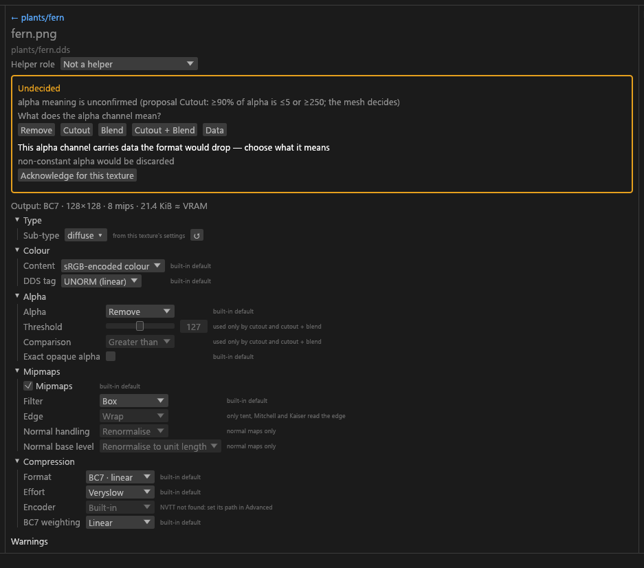

# Texture settings panel

The centre column with one texture selected: its settings, the questions it still needs answered, and how edits are written to `sdc.toml`. For anyone deciding or tuning a texture. Several selected textures share one panel; see [Bulk editing](GUI-Bulk-and-Rename.md#editing-them-together).

## Centre

The settings of the selected texture, in groups: Type, Colour, Alpha, Mipmaps, Compression. Each value shows where it came from: the preset, the config, the analysis, or your `[files]` entry (for example "from sdc.toml", "suggested", or "from the meshes that use this texture"). Selecting a set shows the set editor instead.

| Row | Choices |
|---|---|
| Sub-type | Grouped as PBR (Community Shaders), Advanced skin (Community Shaders), Colour maps, Normal maps, Grayscale maps, Packed and data, HDR maps, Other. Only sub-types the current Mode allows are offered, plus the texture's current sub-type. The list opens under the field with a search box and the suggested type on top, the same picker as the Problems tab's **Set type…**. |
| Content | sRGB-encoded colour, or Linear data. |
| DDS tag | _SRGB or UNORM (linear), limited to what the format and Mode allow. |
| Alpha | The alpha policy ([values](Project-Config-Fields.md#alpha)). |
| Threshold, Comparison | Slider 1 to 254; Greater than, or Greater than or equal. |
| Coverage, Exact opaque alpha | Auto / On / Off; on or off. |
| Normal handling, Normal base level | Renormalise or Renormalise and bake; Renormalise to unit length or Keep as authored. |
| Mipmaps: Levels, Filter, Edge | Full chain or None (base level only); Box, Tent, Mitchell, Kaiser; Wrap or Clamp. |
| Format, Effort, Encoder, BC7 weighting | The block formats plus RGBA8, R8, RG8 and (under `cs`) RGBA16F; bc7e effort; Built-in or NVTT Production; Linear, Perceptual, Alpha ×2, ×8 or ×16. |

Options a texture cannot use are greyed out, with the reason on hover.

**Output size.** The settings start with a line such as *Output: BC7 · 2048×2048 · 12 mips · 5.3 MiB ≈ VRAM*: the format, the size after any resize, the number of mip levels and the bytes of the whole chain (hover for the exact bytes, the header and the file size). The status line under the header and the bulk panel add *≈ VRAM: selection … · folder …*, the total over the selected textures and over every texture that is, or will be once decided, written. A compressed size is also what the texture takes in video memory. A source whose size cannot be read cheaply (a PSD) has no estimate and is counted as "unsized", as is a texture whose size is still being read in the background. A size read that fails is tried again once, at the next plan; after that the file stays unsized for the session, and the Messages log says so.

**Compression.** For an emissive it shows the `FMT-HDR-SOURCE` reason (why it is BC6H or BC7 sRGB). The format dropdown also lists the uncompressed formats (`RGBA8`, `R8`, `RG8`, and `RGBA16F` only under `cs`); Effort is locked for them.

**Encoder** is **Built-in** or **NVTT Production**. NVTT is a quality option for BC7 and BC6H only, 40 to 60 times slower ([NVTT backend](NVTT-Backend.md)).

- When the row is locked or hidden, and what a format change does: [In the GUI](NVTT-Backend.md#in-the-gui).
- A failed nvcompress fails that file (`ENC-NVTT-FAILED`); there is no silent fallback.

**Mipmaps: Filter and Edge.** *Filter* picks *Box* (the default), *Tent*, *Mitchell* or *Kaiser*. Tent, Mitchell and Kaiser are only for sRGB colour without alpha weighting (not cutout or blend); an HDR texture (BC6H or RGBA16F) may use Box or Tent only. *Edge* (*Wrap*, the default, or *Clamp*) is locked while the filter is Box, because only Tent, Mitchell and Kaiser read past the edge.

**Normal base level** (normal maps only) stores mip 0 at unit length by default; choose *Keep as authored* for a normal map whose short normals are deliberate. A PBR set's normal map also bakes its detail into the set's `_rmaos`/`_rfaos` roughness (including a normal map shared into another set, which bakes into that set's own roughness); its Normal handling row then reads *decided by the texture set*. A `_cnr` bakes its detail into its own coat roughness by default, so its row reads *built-in default*.

**Enable parallax** (complex material `_m` only) sits in the Alpha group.

- Ticked, the `_m` alpha is kept as the parallax height. Unticked, the alpha is written as 0 at every mip: complex material stays on and parallax is off.
- It starts ticked when the source alpha varies, and unticked when the alpha is constant (solid 255, mid grey, 0) or missing.
- A source without an alpha channel cannot turn it on; the box is greyed out, with the reason on hover. **↺** clears a value set on the texture itself.
- The row is hidden when the alpha is removed (the `_m` alpha is then 255).
- The same box is under the slot rows in the set editor, on the `_m`'s entry, and the bulk panel lists it for a selection of complex `_m` textures.

**DDS files.** A DDS in the folder shows its header check, a *Tag on patch* choice and **Patch header…**, then **Patch**, which writes a patched copy to the export folder. The DDS itself is never changed.

**Used by meshes.** When a mod scan exists, the settings end with a collapsed **Used by meshes (N)** list: each mesh that uses the texture, with its mod and MO2 priority, the winner first (loose files before BSAs, then the highest priority).

- When the meshes decided the texture's alpha meaning, the meshes whose alpha property gave that answer are marked **decided alpha** (for blend, every blending mesh; for cutout, the meshes testing at the threshold used).
- The list is read in the background and shows 200 meshes, then "and N more". It is read again after a scan. The read starts once the selection has stayed on the texture for 150 ms, so holding Up or Down reads only where you stop. A read that fails shows its error in the list.
- **Show in Meshes**, under the list, switches to the Meshes view on **Any mod** with the search and chips cleared and a **Uses <texture> ✕** chip, so the list shows just the meshes that use the texture. The chip's **✕** clears it, and the selected mesh stays selected.

### BC7 weighting against BC3

*BC7 weighting* (Compression, and in the Advanced drawer) sets how much the built-in BC7 encoder weighs alpha against colour. It shows only for BC7 with the built-in encoder (otherwise hidden, with "BC7 only" or "used only by the built-in BC7 encoder"). Each option has one line of hover text:

| Option | Use | Writes |
|---|---|---|
| **Linear** (the default) | Every channel weighs the same. | Clears `encoder.perceptual` and `encoder.bc7_weights`; over an inherited value from `sdc.toml` or a rule, writes `perceptual = false` and `bc7_weights = "linear"`. |
| **Perceptual** | bc7e's own weights. Greyed out on anything but colour without data alpha. | `perceptual = true` |
| **Alpha ×2**, **Alpha ×8**, **Alpha ×16** | Alpha error counts 2, 8 or 16 times. ×8 is an alternative to BC3 for delicate alpha; ×16 suits a `_n` with specular in alpha. | `bc7_weights` (and `perceptual = false` over an inherited perceptual) |

One pick is enough even when the texture's own value hid an inherited one: once the plan shows what was underneath, the override is written in the same undo step. The reset clears both keys. Changing the format away from BC7 drops the texture's own weighting. In the Advanced drawer the row is greyed out, with the same reasons, where the panel hides it. The bulk editor has the same row: Perceptual skips the textures it is locked for, and *Copy settings* carries a Perceptual pick.

The chart compares each weighting with BC3, as mean PSNR in dB, on three kinds of texture.

For colour with smooth alpha, Alpha ×8 beats BC3 on alpha and keeps 5.6 dB more RGB. For specular in the alpha of a normal map or an `_rmaos`, BC3 still has the highest alpha; BC7 closes the gap as the weight rises, and keeps the better RGB or normals. The "w4" row was measured in the study but is not a dropdown option. The full results (SSIM, max error, exact 0 and 255, per texture class) are in [BC7 alpha weights](../research/bc7-alpha-weights.md).

## Deciding

A texture whose name follows the conventions decides itself: a High-confidence suggestion is accepted and written to the project ([below](#what-the-gui-writes-on-its-own)). Until then its sub-type reads **(auto)**, with the reason on hover. High suggestions include a known suffix such as `_n`, `_rmaos` or `_rfaos`; an exporter term such as `_albedo`; a file with no suffix, as its set's colour map; and `_n` in a PBR set. The naming rules are in [Texture types](Texture-Types.md).

Naming that breaks the conventions (a normal map saved without `_n`) is read as a colour map, so rename the file ([Renaming](GUI-Bulk-and-Rename.md#renaming)) or choose its sub-type.

A texture that still needs an answer has an **amber border**: a Medium or Low sub-type suggestion, the meaning of its alpha, or a blocking warning you must acknowledge. The centre column then shows an *Undecided* box with the question:

| Question | Controls |
|---|---|
| What kind of texture is this? | A sub-type dropdown and **Confirm**. |
| What does the alpha channel mean? | *Remove*, *Cutout*, *Blend*, *Cutout + Blend*, *Data*. |
| An info line "IN-GREEN-UNSTATED" on a plain `_normal` | The map is converted as DirectX. Press *Treat as OpenGL (flip green)* if it is an OpenGL map; an OpenGL file then shows *Green: OpenGL (flipped)* with a *Treat as DirectX* button that undoes it. |
| A blocking warning | **Acknowledge for this texture**. For `DIM-NPOT` (a size that is not a power of two) there is also **Resize to a power of two**, which writes `resize = "pot-down"` and clears the block. |

Each answer is written to `sdc.toml`, as a field value or as an `allow` code on the file's `[files]` entry, so it stays in your project file. A choice you make always wins over a suggestion. The **Sub-type** field opens the same type picker as the Problems tab's **Set type…**, with the engine's suggestion on top.

### What the GUI writes on its own

When a plan settles, every sub-type it took from a High-confidence suggestion (including a type the scanned meshes or a GRAS grass model gave it) and every alpha meaning it took from the meshes is written to `sdc.toml` as a `[files]` entry, as if you had chosen it.

- It is one undo step, `Set {n} types automatically`, and one Info row in Problems, "{n} types set automatically (High confidence)", with **Undo this change** and the list of textures on hover. Both say *values* instead of *types* when an alpha meaning is among them.
- The project then has unsaved changes. Save keeps them, and `sdc convert` reads the same types without `--accept-suggestions high` and without the scan.
- A file you already gave a sub-type or alpha policy is never touched. An Undo of the step stays undone until the folder is opened again.
- A written type is a value of the project: it reads as a set value, without **(auto)**, and a later scan does not change it (the scan's view shows as a suggestion).
- While it is still the type Tessalith would pick by itself, these re-type it: a set shader you pick (written to the project too, since `sdc convert` does not read set shaders) or going back to Auto, deciding a set's diffuse as a PBR albedo (its members follow), or a new preset alias. A type you changed is kept. The writing is always an undo step of its own, also when an edit of yours led to it.
- Two decisions stay in the GUI only: a mesh *Remove* (written out, it would change the format the compact presets pick), and the environment-map `_m` that Also export derives from the meshes (`sdc convert` writes no `_m`).

### Alpha from the meshes

After a mod scan ([Mod scanning](Mod-Scanning.md)), a colour map whose alpha varies takes its alpha meaning from the meshes that use it, and the alpha question is not asked:

| Meshes using the texture | Result |
|---|---|
| Any mesh with alpha blending | Blend |
| Alpha testing | Cutout, at the strictest mesh threshold |
| Both | Cutout + Blend |
| No mesh with alpha | Remove |

The Alpha row then reads *from the meshes that use this texture*. A texture with no alpha, or a fully opaque one, keeps *Remove*. Your own choice still wins. Right after a folder opens, the question shows until the scan has been read.

## Editing

Any field in the centre column can be changed. The change goes into `sdc.toml` as a `[files."<path>"]` entry, keyed by the file's path relative to the folder holding `sdc.toml`. Packed outputs are keyed without an extension, for example `landscape/rock01_rmaos`.

The GUI writes only `target`, `preset`, the `[files.*]` tables, `[inputs.*]` aliases and `defaults.packing.fill.*`. Comments, ordering, rules and every other table in your `sdc.toml` are left byte for byte as they were.

Per-texture `[files]` entries sit above preset and config rules and analysis, and below any `--set` on the command line, so `sdc convert <folder>` honours them ([Project config](Project-Config.md#files)).

Unsaved edits put a dot in the window title until you save with **Save** or **Ctrl+S**; Export saves first. If `sdc.toml` changes on disk while you have unsaved edits, saving asks whether to reload it (**Reload from disk**) or overwrite it (**Overwrite with my changes**). Without unsaved edits, the GUI reloads it when the window regains focus or when you save or export. The other unsaved-changes dialogs are listed under [Dialogs](GUI-Dialogs.md#dialogs).

**Encoding follows type.** When a texture's sub-type changes (a set shader, a slot command, a drag, or a sub-type edit), a format and tag you set on it that the new type does not allow are reset, so the new type's default applies. An info row in Problems says which, with **Undo this change**. Settings that are still valid are kept, and a texture in a pinned slot is left alone and named in that row. One undo restores both the change and the reset.

**Resize** is in the Advanced drawer ([Advanced texture fields](GUI-Advanced-Drawer.md#advanced-drawer)). A resized texture shows a `DIM-RESIZED` note.
